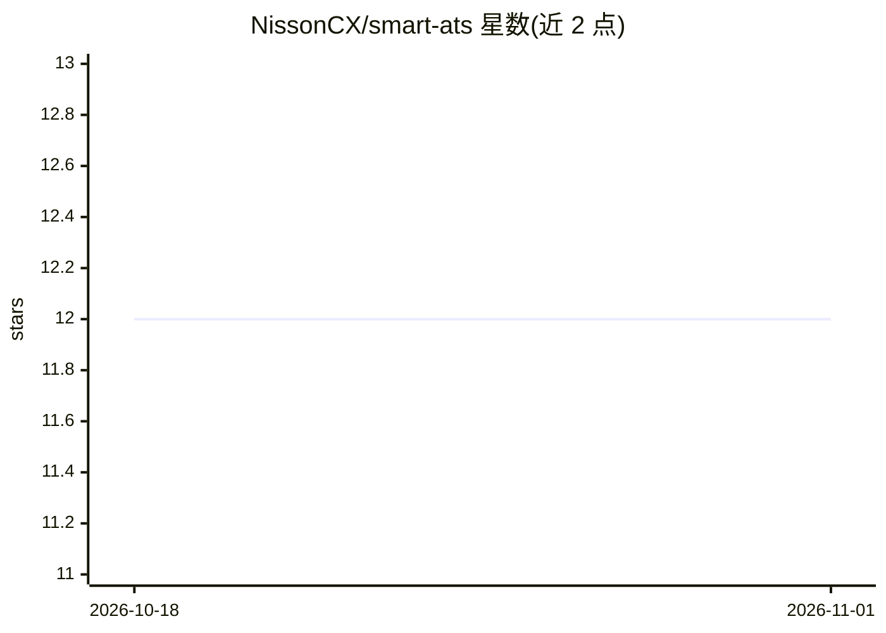

# NissonCX/smart-ats

⭐ 12 · Java · MIT · 推送 2026-02-25 · [GitHub](https://github.com/NissonCX/smart-ats) · 个人维护 · 中文 README

**面向 HR 的 AI 招聘管理系统，含简历解析与 RAG 语义搜索**

基于 Spring Boot 3、智谱AI 与 Milvus 的智能 ATS 系统，面向 HR 用户：支持 PDF/DOC/DOCX 简历上传与 AI 结构化解析、职位发布→申请→面试的完整招聘流程管理、基于 Milvus 向量库与 embedding-3 的 RAG 自然语言候选人搜索，以及 HMAC-SHA256 签名的 Webhook 事件通知。异步管道采用 RabbitMQ + Redisson 分布式锁 + 死信队列。作者声明这是学习项目，需自备智谱AI API Key，并通过 Docker Compose 启动 MySQL/Redis/RabbitMQ/MinIO/Milvus 等基础设施。

## 筛选速览

| 维度 | 判定 | 备注 |
|---|---|---|
| AI 角色 | `ai-native` | 本体是模型或模型工具 |
| 许可风险 | `permissive` | MIT |
| 部署形态 | `self-host` | docker 或自建部署 |
| 模型依赖 | — | README 未给出锁定关系 |
| 硬件要求 | — | 无带数字的原话,不猜 |
| 安装摩擦 | `low` | 无编译、无系统依赖或容器化 |
| 成熟度 | `idea` | |

## 能力要点

- 智谱AI 自动解析简历为结构化候选人数据
- Milvus + embedding-3 的 RAG 语义候选人搜索
- RabbitMQ + Redisson 分布式锁 + 死信队列的异步处理管道
- 40 个 REST API 端点与 190 个测试用例

## 适用场景

- 上传简历后自动提取姓名、技能、工作经历等结构化数据
- 用自然语言语义搜索候选人
- 管理职位发布、投递申请与面试安排的全流程

## 场景标签

`RAG` `语义搜索` `文档解析` · 领域:知识与检索

## 证据(README 行号)

> L14: **SmartATS**（Smart Applicant Tracking System）是一套面向 HR 的智能招聘管理系统。系统支持简历上传、AI 自动解析结构化信息、完整招聘流程管理（职位申请、面试安排）、RAG 语义候选人
> L20: - **AI 简历解析** — 上传 PDF/DOC/DOCX 简历，智谱AI 自动提取姓名、技能、工作经历等结构化数据
> L22: - **RAG 语义搜索** — Milvus 向量数据库 + embedding-3 嵌入模型，自然语言搜索候选人

## 星数曲线

2026-10-18 12 → 2026-11-01 12（+0）

---
*卡片 v1 · prompt 1.4 · 生成 2026-11-01 · 置信度 high · 依据 README sha `e57b2c81ea68` · [字段定义](../../DATASET.md)*
