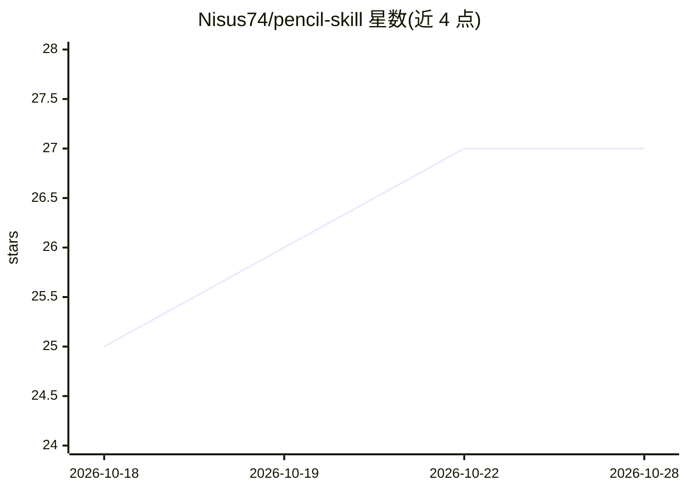

# Nisus74/pencil-skill

⭐ 27 · Python · MIT · 推送 2026-07-26 · [GitHub](https://github.com/Nisus74/pencil-skill) · 个人维护

**教 AI 编码工具操作 pencil.dev 设计文件的技能插件**

非官方社区插件，为 Claude Code、Cursor、Codex 等 AI 编码工具安装 pencil-design 技能：通过 SKILL.md 与 50 个按需加载的参考文件，指导 AI 完成七步设计工作流，讲解 9 个 Pencil MCP 工具的调用方式、成本速查与组合配方，附 15 个完整示例与各平台工具名映射。需自备 AI 编码工具、Pencil MCP server 与 Pencil.dev 工作区。版本 0.8.0，自称 pre-release。提供插件市场安装、文件夹复制、fork 安装三种途径。

## 筛选速览

| 维度 | 判定 | 备注 |
|---|---|---|
| AI 角色 | `ai-ecosystem` | LLM/agent 周边工具 |
| 许可风险 | `permissive` | MIT |
| 部署形态 | `library` | 以包/库形式分发 |
| 模型依赖 | — | README 未给出锁定关系 |
| 硬件要求 | — | 无带数字的原话,不猜 |
| 安装摩擦 | `low` | 无编译、无系统依赖或容器化 |
| 成熟度 | `idea` | |

## 能力要点

- 七步设计工作流（detect→orient→plan→execute→verify→report）
- 覆盖 9 个 Pencil MCP 工具的调用示例与成本速查
- 15 个完整 MCP 工具调用序列示例
- 跨平台：Claude Code / Cursor / Codex 共用同一技能

## 适用场景

- 让 Claude Code 或 Cursor 直接生成和修改 .pen 设计文件
- 通过自然语言完成 dashboard、登录页等 UI 设计
- 团队按自身工作流定制技能内容（fork 方式）

## 场景标签

 · 领域:开发工具/设计工具

## 证据(README 行号)

> L14: Pencil.dev is a collaborative design tool for creating web and mobile interfaces via the Pencil MCP server. This sk
> L17: - Teaches all 9 Pencil MCP tools with worked invocations, cost cheatsheet, and composite recipes

## 星数曲线

2026-10-18 25 → 2026-10-28 27（+2）

---
*卡片 v1 · prompt 1.4 · 生成 2026-10-26 · 置信度 high · 依据 README sha `525552e195e0` · [字段定义](../../DATASET.md)*
