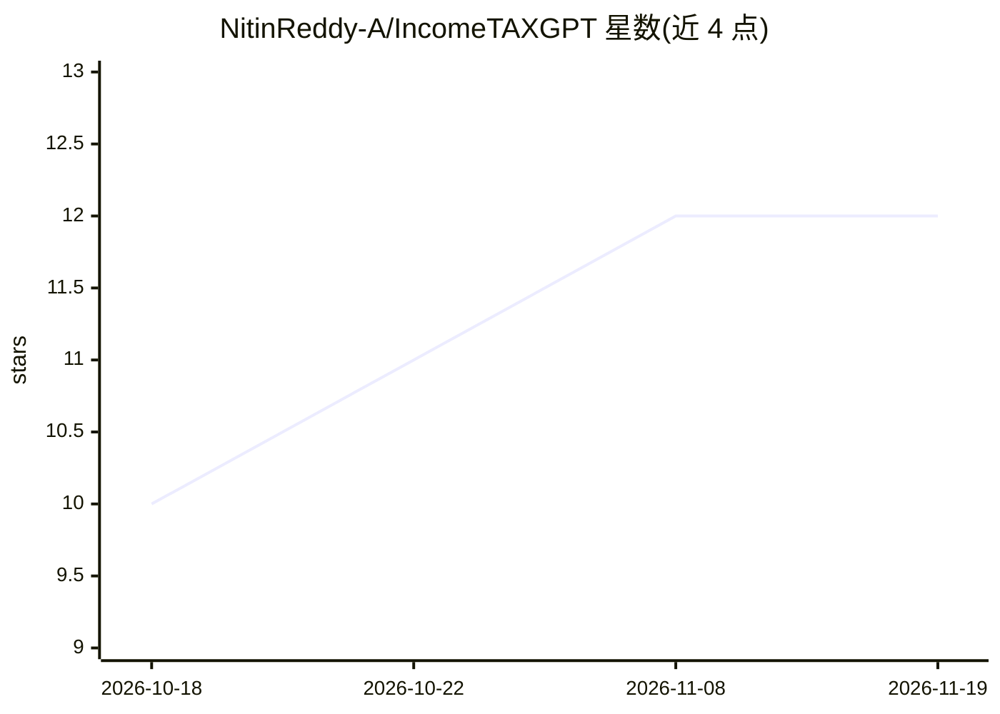

# NitinReddy-A/IncomeTAXGPT

⭐ 12 · Python · MIT · 推送 2026-10-04 · [GitHub](https://github.com/NitinReddy-A/IncomeTAXGPT) · 个人维护

**面向印度所得税的本地 RAG 问答助手，带页级引用**

以 RAG 方式回答印度所得税问题的本地问答助手：用户提供所得稅法、规则与 CBDT 通告等 PDF，系统按页切分文本、用 MiniLM 嵌入后写入 Pinecone serverless 索引；提问时检索 Top 4 片段交给本地运行的 Llama 2 7B Chat GGUF（ctransformers，CPU）生成回答，并附文件与页码引用。LLM 与嵌入模型均在本地运行，无需 API 计费，问题文本不发送给 AI 提供商。通过 Streamlit 聊天界面流式输出，CPU 推理耗时数十秒到数分钟。

## 筛选速览

| 维度 | 判定 | 备注 |
|---|---|---|
| AI 角色 | `ai-native` | 本体是模型或模型工具 |
| 许可风险 | `permissive` | MIT |
| 部署形态 | `library` | 以包/库形式分发 |
| 模型依赖 | local-ok | 支持本地模型 |
| 硬件要求 | — | 无带数字的原话,不猜 |
| 安装摩擦 | `medium` | 含编译或系统依赖之一 |
| 成熟度 | `idea` | |

## 能力要点

- 每条回答列出所依据的文件与页码及对应摘录
- Llama 2 7B GGUF 在 CPU 本地运行，8 GB 内存即可，无需 GPU 与 API key
- 更新税法仅需替换 PDF 并重跑 ingest，确定性 chunk ID 原地更新向量
- 模型仅基于检索片段作答，不覆盖时回答不知道

## 适用场景

- 报税前查询扣除项、表格、预缴税等日常问题
- 会计师事务所在自有法条与通告集合上搭建内部检索工具
- 税法考试学生对照原文理解条文

## 场景标签

`RAG` `文档问答` `聊天机器人` · 领域:对话与助手

## 证据(README 行号)

> L10: IndianTaxGPT is a question-answering assistant for Indian income tax. You give it the documents
> L60: IndianTaxGPT uses retrieval-augmented generation (RAG). Documents are split into passages and
> L75: |LLM|Llama 2 7B Chat, 4-bit GGUF, run with ctransformers|Runs on a laptop with 8 GB RAM. No GPU and no API key need

## 星数曲线

2026-10-18 10 → 2026-11-19 12（+2）

---
*卡片 v1 · prompt 1.4 · 生成 2026-11-18 · 置信度 high · 依据 README sha `c7bbc4bdd20d` · [字段定义](../../DATASET.md)*
