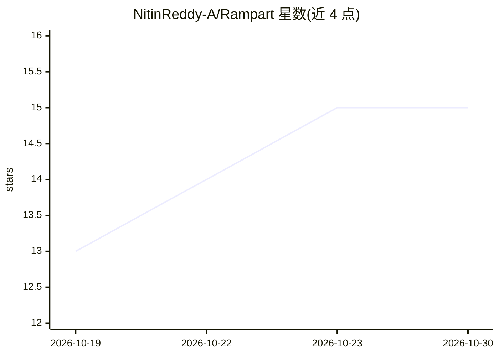

# NitinReddy-A/Rampart

⭐ 15 · Python · Apache-2.0 · 推送 2026-10-26 · [GitHub](https://github.com/NitinReddy-A/Rampart) · [官网](https://rampart.dpdns.org) · 个人维护

**面向开发者的自托管 AppSec 代理：只报告可复现证明的 Web/API 漏洞**

开源、自托管的应用安全测试工具，扫描 Web 应用、API 与 LLM 端点的 IDOR/BOLA、SQL 注入、XSS、SSRF 等漏洞类别。核心机制是证据优先：每个候选发现须经独立确定性 oracle（探针+阴性对照+两次复现）复证才标记为 confirmed，无法复现的列为 Dropped。安全管线为 allowlist→scope→risk→policy→audit，每个请求过统一准入点，需有效 YAML scope 授权合约才会运行，默认无 LLM、纯标准库 Python、离线可用，LLM（Claude Code/OpenAI 兼容/Ollama）为可选增强。提供 CLI、Python SDK、MCP server 与 GitHub Action 接入方式，报告含 CWE/CVSS 4.0 与 8 个合规框架映射。

## 筛选速览

| 维度 | 判定 | 备注 |
|---|---|---|
| AI 角色 | `ai-enhanced` | 去掉 AI 部分产品仍成立 |
| 许可风险 | `permissive` | Apache-2.0 |
| 部署形态 | `desktop` | 安装包/桌面程序 |
| 模型依赖 | local-ok | 支持本地模型 |
| 硬件要求 | — | 无带数字的原话,不猜 |
| 安装摩擦 | `low` | 无编译、无系统依赖或容器化 |
| 成熟度 | — | 结构信号不足 |

## 能力要点

- 独立确定性 oracle 复证（探针+阴性对照+两次复现）后才确认发现
- allowlist→scope→risk→policy→audit 安全管线，每个请求过统一准入点，须有效 scope 授权合约
- 默认无 LLM、零运行时依赖（纯标准库 Python），离线确定性运行
- 覆盖 Web/API、gRPC、IaC、SCA、OWASP LLM Top 10 部分风险类别的检测，报告映射 CWE/CVSS 4.0 与 8 个合规框架

## 适用场景

- 在 CI 中作为安全门禁，只报告可复现证明的漏洞
- 渗透测试前自动化执行重复性检查并留存审计日志
- 为 SOC 2/ISO 27001/PCI DSS 等审计准备控制证据
- 对 LLM 端点执行 OWASP LLM Top 10 相关探测（提示注入、敏感信息泄漏等）

## 场景标签

`网络安全` · 领域:学习与行业

## 证据(README 行号)

> L7: The open-source, self-hosted security agent for web apps, APIs, and LLM endpoints.
> L45: Runs on your machine or in your CI · **zero runtime dependencies** (pure standard-library Python) · **no LLM requir
> L90: |Optional LLM reasoning (Claude Code, OpenAI-compatible, Ollama)|✗|✓|**✓**|

## 星数曲线

2026-10-19 13 → 2026-10-30 15（+2）

---
*卡片 v1 · prompt 1.4 · 生成 2026-10-30 · 置信度 high · 依据 README sha `b374f77fba57` · [字段定义](../../DATASET.md)*
