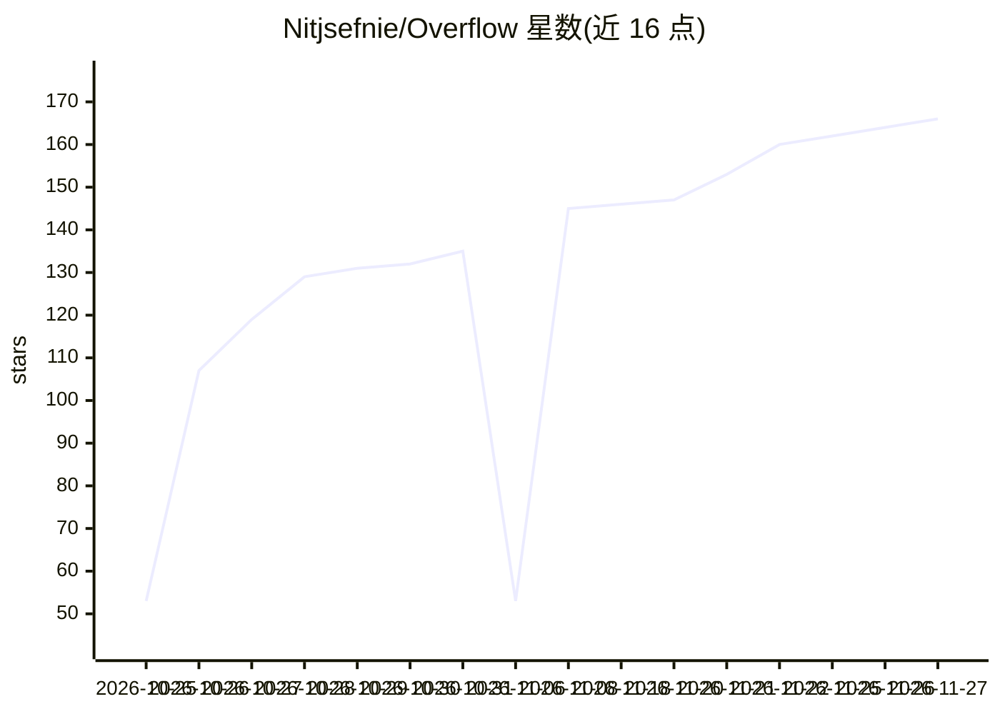

# Nitjsefnie/Overflow

⭐ 166 · TypeScript · MIT · 推送 2026-11-26 · [GitHub](https://github.com/Nitjsefnie/Overflow) · [官网](https://overflow.nitjsefni.eu) · 个人维护

**用互助记账协调开源贡献的共享账本服务**

Overflow 是一个开源协作的共享记账平台：仓库发起人用标签为 issue 定价，外部贡献者完成工作并合并关闭该 issue 的 PR 后获得积分，发起人账户被扣分；积分是共享账本上的点数，不涉及金钱与代币。结算依赖 GitHub/GitLab webhook、标签目录、结算评论与合并提交等可复现证据，账户按 0 起步、负余额发现限制、审计与封禁等规则防滥用。面向有闲置 LLM 订阅额度、时间不均衡的个人与小团队，通过官网用 GitHub 登录注册仓库使用。

## 筛选速览

| 维度 | 判定 | 备注 |
|---|---|---|
| AI 角色 | `ai-enhanced` | 去掉 AI 部分产品仍成立 |
| 许可风险 | `permissive` | MIT |
| 部署形态 | `None` |  |
| 模型依赖 | — | README 未给出锁定关系 |
| 硬件要求 | — | 无带数字的原话,不猜 |
| 安装摩擦 | `low` | 无编译、无系统依赖或容器化 |
| 成熟度 | — | 结构信号不足 |

## 能力要点

- PR 合并后按结算标签与评论在共享账本上记账/扣分
- 每次结算记录标签事件、评论、合并提交与 diff 指纹，可从 GitHub 复现
- 0 起步余额、负余额发现限制、审计/警告/重新校准/封禁的反滥用机制
- 支持 GitHub 为主、GitLab 项目注册（webhook、初始导入、目录变更与注销）

## 适用场景

- 用帮别人修 issue 挣的积分抵扣自己积压 issue 的费用
- 小团队在人力充裕周为紧俏周储备外部支援
- 在自家仓库用标价为积压工作吸引外部贡献者

## 场景标签

 · 领域:开源协作/开发者工具

## 证据(README 行号)

> L7: **Let your spare weeks pay for the dry ones.** Overflow is a shared ledger for open-source work, for people and smal
> L25: 1. A repository sponsor puts a price on an issue with an opening label.
> L27: 3. Between the closing PR's final commit and fifteen minutes after its merge, the sponsor puts an actual-catalog la

## 星数曲线

2026-10-25 53 → 2026-11-27 166（+113）

---
*卡片 v1 · prompt 1.4 · 生成 2026-11-27 · 置信度 mid · 依据 README sha `d6e6745a7e0e` · [字段定义](../../DATASET.md)*
