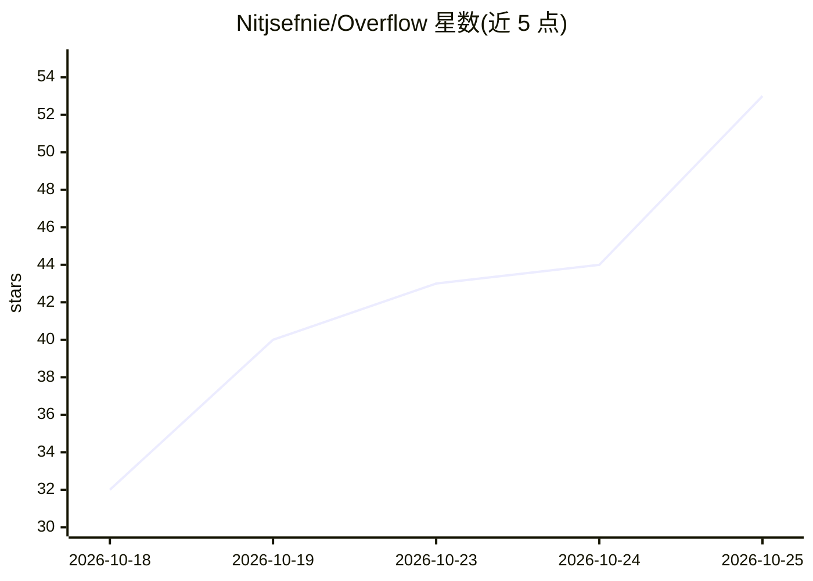

# Nitjsefnie/Overflow

⭐ 107 · TypeScript · MIT · 推送 2026-10-25 · [GitHub](https://github.com/Nitjsefnie/Overflow) · [官网](https://overflow.nitjsefni.eu) · 个人维护

**开源贡献互记分账本：用闲置 LLM 订阅额度结算互助工作**

基于 GitHub issue 与 PR 的互记分（mutual-credit）协作系统：仓库赞助方为 issue 标价，外部贡献者完成工作并提交关闭该 issue 的 PR，合并后贡献者账户记入积分、赞助方账户扣减；积分可在不同仓库间通用。账户初始信用额度为 -10，通过为他人完成工作偿还负余额并提升额度。每笔结算记录标签事件、评论、合并提交与 diff 指纹，数据可从 GitHub 复现；提供审计机制（审计/警告/重校准/封禁）。支持 GitHub 登录注册，GitLab 项目可通过 API token 关联。README 明确指出自建实例无法加入现有交换网络。

## 筛选速览

| 维度 | 判定 | 备注 |
|---|---|---|
| AI 角色 | `ai-ecosystem` | LLM/agent 周边工具 |
| 许可风险 | `permissive` | MIT |
| 部署形态 | `None` |  |
| 模型依赖 | — | README 未给出锁定关系 |
| 硬件要求 | — | 无带数字的原话,不猜 |
| 安装摩擦 | `low` | 无编译、无系统依赖或容器化 |
| 成熟度 | — | 结构信号不足 |

## 能力要点

- 以 GitHub label 与合并 PR 触发的跨仓库共享积分账本
- 结算公式 max(0, 实际分 − 不同审查轮数)，全部数据可从 GitHub 复现
- -10 起始信用额度与偿还后额度递增的反滥用机制
- 提供 API 令牌、账本读取端点及面向 agent 的 MCP 端点

## 适用场景

- 空闲时帮别的仓库修 issue，攒积分换自己积压工作被处理
- 小型团队在产能波动间以贡献换取他人协助
- 通过 API 与 MCP 端点程序化注册仓库和读取账本

## 场景标签

 · 领域:开源协作/积分账本

## 证据(README 行号)

> L7: **Let your spare weeks pay for the dry ones.** Overflow is a shared ledger for open-source work, for people and smal
> L46: - API.md — API tokens, programmatic registration and catalog changes with every error message, the ledger read endp

## 星数曲线

2026-10-18 32 → 2026-10-25 53（+21）

---
*卡片 v1 · prompt 1.4 · 生成 2026-10-24 · 置信度 low · 依据 README sha `c630e8c8798a` · [字段定义](../../DATASET.md)*
