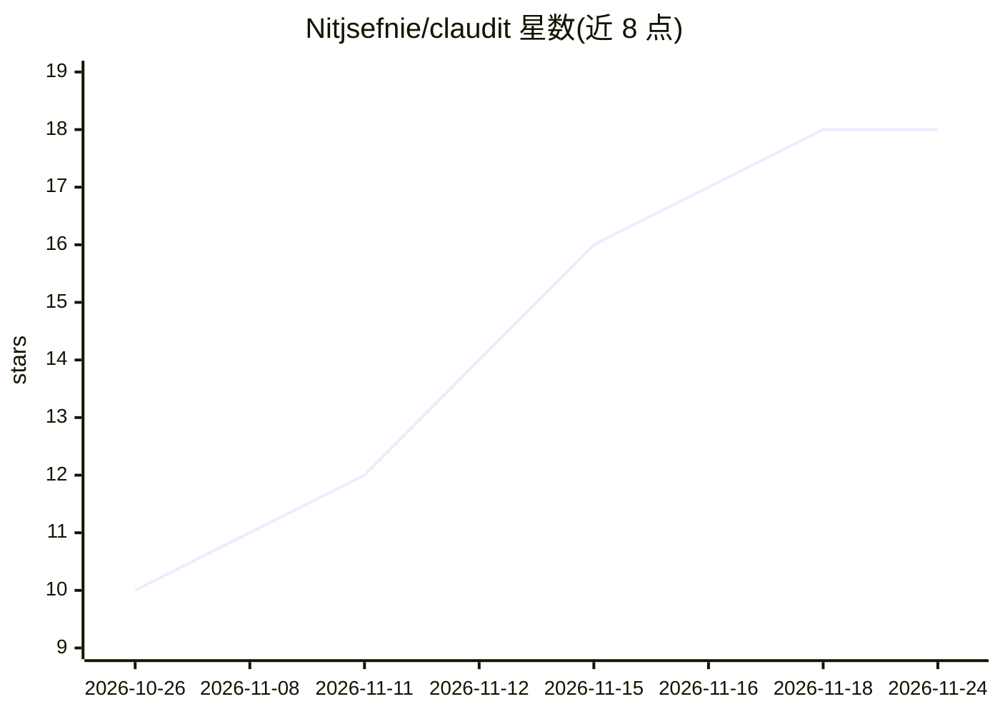

# Nitjsefnie/claudit

⭐ 17 · Python · MIT · 推送 2026-11-24 · [GitHub](https://github.com/Nitjsefnie/claudit) · 个人维护

**自托管 Claude Code 用量仪表盘：成本与项目归因统计**

自托管 Web 应用：FastAPI 后端从 Cloudflare R2 或本地 file:// 镜像摄取会话转录文件，解析入 Postgres，向 React 前端（浏览器内 Babel、无构建步骤）提供仪表盘与原始转录。同一部署可摄取多种格式：Claude Code 会话 JSONL、Codex rollouts 及两种 Kimi CLI 格式。面板覆盖成本、Token 分解、缓存 TTL 拆分、回复延迟、工具错误率、活动热力图等，含按 5 分钟/1 小时 TTL 的缓存计费拆分、跨文件 uuid 去重、限额命中检测。明确不做会话质量分析或 AI 叙述。面板集移植自 nhz-io/ccusage-plot。

## 筛选速览

| 维度 | 判定 | 备注 |
|---|---|---|
| AI 角色 | `ai-ecosystem` | LLM/agent 周边工具 |
| 许可风险 | `permissive` | MIT |
| 部署形态 | `None` |  |
| 模型依赖 | — | README 未给出锁定关系 |
| 硬件要求 | — | 无带数字的原话,不猜 |
| 安装摩擦 | `low` | 无编译、无系统依赖或容器化 |
| 成熟度 | — | 结构信号不足 |

## 能力要点

- TTL 正确的成本核算：ephemeral_5m ×1.25×、ephemeral_1h ×2× 基准价的缓存创建拆分
- 多格式摄取：Claude Code JSONL、Codex rollouts、Kimi kimi-code/legacy 共入同一套表
- 跨文件 uuid 去重（records.is_canonical）避免子代理转录重复计数
- 实时更新：server-sent ingest_done 事件触发数据重取

## 适用场景

- 查看我在 Claude Code 上花了多少钱、Token 用在哪、何时活跃
- 按项目归因统计多个 CLI 工具的用量与成本
- 监控回复延迟、工具错误率与限额命中情况

## 场景标签

`LLM 可观测性` · 领域:评测与运维

## 证据(README 行号)

> L3: **Claude Code Usage Dashboard** — a self-hosted web app for visualising AI
> L6: A FastAPI backend ingests transcripts from Cloudflare R2 (or a local `file://`
> L15: claudit **exposes statistics** about Claude Code usage: how much you spent,

## 星数曲线

2026-10-26 10 → 2026-11-24 18（+8）

---
*卡片 v1 · prompt 1.4 · 生成 2026-11-18 · 置信度 high · 依据 README sha `7cc2ae462c9b` · [字段定义](../../DATASET.md)*
