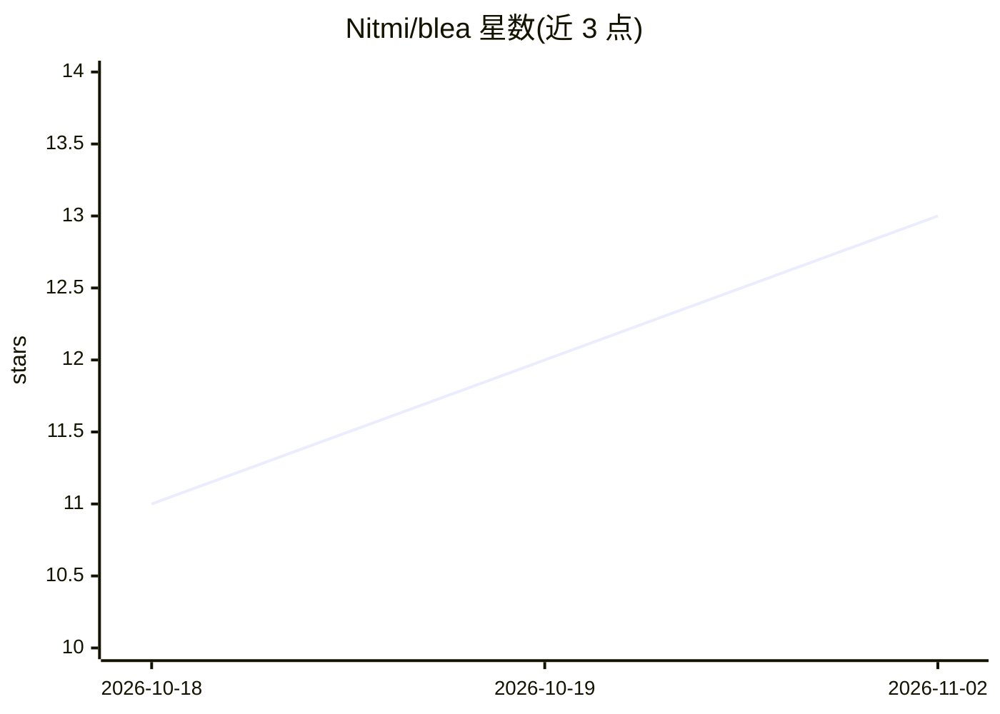

# Nitmi/blea

⭐ 13 · Python · MIT · 推送 2026-09-29 · [GitHub](https://github.com/Nitmi/blea) · 个人维护

**供 AI agent 安全执行 BLE 诊断与自动化的插件与 CLI 运行时**

BLEA 是一个面向 AI agent 的蓝牙低功耗（BLE）工具集：以 `ble` 可执行文件为共享运行时，提供确定性 JSON 输出的 CLI、本地 stdio MCP 服务器、可移植 Agent Skill 与 Agent Plugins 1.0.0 声明。功能覆盖扫描、GATT 检查、notify 观察、只读证据采集（Evidence Format v1）、离线 diff 与 replay、受多重守卫的写入与配对。安装途径含 PyPI、uv、npm Skills CLI、Codex marketplace、OpenClaw/ClawHub，Windows 另有单文件 exe 发布。Python 运行时需 3.10+，蓝牙访问经 Bleak 由操作系统提供。

## 筛选速览

| 维度 | 判定 | 备注 |
|---|---|---|
| AI 角色 | `ai-ecosystem` | LLM/agent 周边工具 |
| 许可风险 | `permissive` | MIT |
| 部署形态 | `desktop` | 安装包/桌面程序 |
| 模型依赖 | — | README 未给出锁定关系 |
| 硬件要求 | — | 无带数字的原话,不猜 |
| 安装摩擦 | `low` | 无编译、无系统依赖或容器化 |
| 成熟度 | — | 结构信号不足 |

## 能力要点

- CLI/MCP/Skill 三层共用一个 `ble` 运行时
- 只读证据采集与离线 diff/replay（无需适配器或设备）
- 写入与配对需显式授权与设备确认等多重守卫
- Windows 单文件 exe 发布并带 SHA-256 清单与构建溯源验证

## 适用场景

- 让 AI agent 扫描并检查附近 BLE 设备的 GATT 服务
- 采集只读证据包并在 CI 中用 diff 检测设备状态变化
- 无蓝牙硬件时 replay 证据包进行确定性测试

## 场景标签

 · 领域:硬件自动化/Agent 工具

## 证据(README 行号)

> L11: BLEA — **Bluetooth Low Energy Automation** — is a universal Agent Plugin for safe, deterministic
> L12: BLE work. It gives AI agents a portable Skill, a machine-readable CLI, a local MCP server, guarded
> L27: The `ble` executable is the shared runtime. Regular subcommands use the CLI surface; `ble mcp`

## 星数曲线

2026-10-18 11 → 2026-11-02 13（+2）

---
*卡片 v1 · prompt 1.4 · 生成 2026-11-01 · 置信度 mid · 依据 README sha `8032f7c1e131` · [字段定义](../../DATASET.md)*
