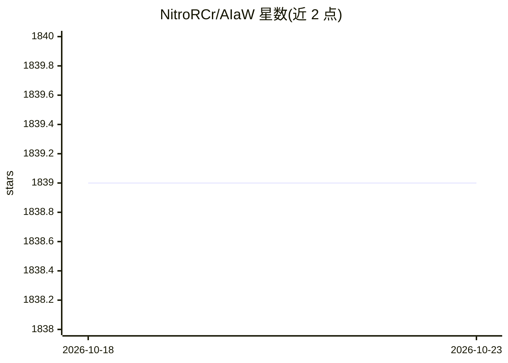

# NitroRCr/AIaW

⭐ 1,839 · TypeScript · BSD-3-Clause · 推送 2026-05-18 · [GitHub](https://github.com/NitroRCr/AIaW) · [官网](https://aiaw.app) · 个人维护 · 中文 README

**跨平台 AI 聊天客户端：多工作区、插件与本地优先同步**

面向终端用户的 AI 对话客户端，支持 Windows/Linux/macOS/Android/Web(PWA)，可接入 OpenAI、Anthropic、Google、DeepSeek、xAI、Azure 等多家模型服务商。数据本地优先存储、登录后云同步；功能含多工作区、分支式对话、Artifacts（可编辑带版本控制）、MCP 协议（Tools/Prompts/Resources，STDIO 与 HTTP）、基于 SearXNG 的网页搜索、插件市场与动态提示词模板。开发运行依赖 pnpm 与 Quasar 构建。注意：项目已声明废弃，由重写版 Nya AI 接续。

## 筛选速览

| 维度 | 判定 | 备注 |
|---|---|---|
| AI 角色 | `ai-native` | 本体是模型或模型工具 |
| 许可风险 | `permissive` | BSD-3-Clause |
| 部署形态 | `library` | 以包/库形式分发 |
| 模型依赖 | — | README 未给出锁定关系 |
| 硬件要求 | — | 无带数字的原话,不猜 |
| 安装摩擦 | `low` | 无编译、无系统依赖或容器化 |
| 成熟度 | — | 结构信号不足 |

## 能力要点

- 接入多家 AI 服务商（OpenAI/Anthropic/Google/DeepSeek/xAI/Azure 等）
- 本地优先存储 + 登录云同步，离线可用
- 支持 MCP 协议（Tools/Prompts/Resources，STDIO 与 HTTP 连接）
- Artifacts 可编辑、带版本控制与读写权限控制；插件市场可扩展

## 适用场景

- 在不同设备上与多家 AI 服务商对话并保持数据同步
- 按主题划分工作区、配置助手与提示词模板管理对话
- 通过 MCP 与插件扩展 AI 的工具调用能力

## 场景标签

`聊天机器人` · 领域:对话与助手

## 证据(README 行号)

> L9: An elegant AI client
> L22: - Multiple AI providers: OpenAI, Anthropic, Google, DeepSeek, xAI, Azure, etc.

## 星数曲线

2026-10-18 1,839 → 2026-10-23 1,839（+0）

---
*卡片 v1 · prompt 1.4 · 生成 2026-10-21 · 置信度 high · 依据 README sha `161b0890aa2b` · [字段定义](../../DATASET.md)*
