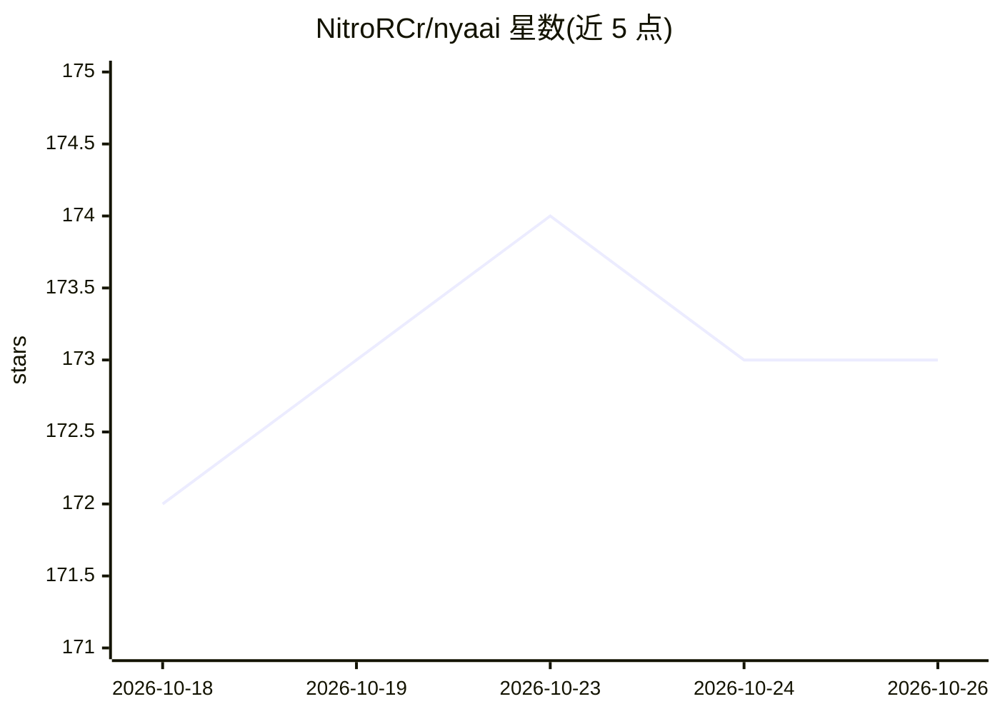

# NitroRCr/nyaai

⭐ 173 · Vue · Apache-2.0 · 推送 2026-07-17 · [GitHub](https://github.com/NitroRCr/nyaai) · [官网](https://docs.nyaai.cc) · 个人维护 · 中文 README

**一体化协作平台：AI 对话为核心，含笔记、网盘与频道**

以 AI Chat 为核心功能的协作平台，同一工作区内提供 AI 对话、网页搜索与爬取、笔记/文档页（类 Notion 协作页）、频道沟通、文件管理与网盘、全文检索及发布分享。AI 部分支持消息分支、文档解析输入、MCP 工具/资源/提示词接入、多模态输入输出、BYOK 自定义模型提供商。支持创建工作区邀请团队并共享 AI 配额与存储；内容云端存储，PWA 可安装到移动设备主屏；支持自托管，文档另见 Self-hosting 指南。

## 筛选速览

| 维度 | 判定 | 备注 |
|---|---|---|
| AI 角色 | `ai-native` | 本体是模型或模型工具 |
| 许可风险 | `permissive` | Apache-2.0 |
| 部署形态 | `None` |  |
| 模型依赖 | — | README 未给出锁定关系 |
| 硬件要求 | — | 无带数字的原话,不猜 |
| 安装摩擦 | `low` | 无编译、无系统依赖或容器化 |
| 成熟度 | — | 结构信号不足 |

## 能力要点

- AI Chat 为核心功能：消息分支、文档解析输入、多模态
- MCP 接入（Tools/Resources/Prompts）与 BYOK 自定义提供商
- 工作区全文检索与 Workspace Search 插件实现工作区 RAG
- 类 Notion 协作页、网盘、发布分享与云端多端访问（PWA）

## 适用场景

- 在同一工作区完成 AI 对话、笔记、文档与团队协作
- 团队共享 AI 配额与存储，协作管理知识库
- 自托管部署一套含 AI 对话能力的协作平台

## 场景标签

`聊天机器人` `知识库管理` · 领域:对话与助手

## 证据(README 行号)

> L5: Nya AI combines AI chat client and collaboration platform, enabling you to chat with AI, search the web, take notes,
> L9: Unlike the added AI features of other collaboration platforms, AI Chat is our core feature, designed to fully replac

## 星数曲线

2026-10-18 172 → 2026-10-26 173（+1）

---
*卡片 v1 · prompt 1.4 · 生成 2026-10-22 · 置信度 high · 依据 README sha `e00c40e0f2d7` · [字段定义](../../DATASET.md)*
