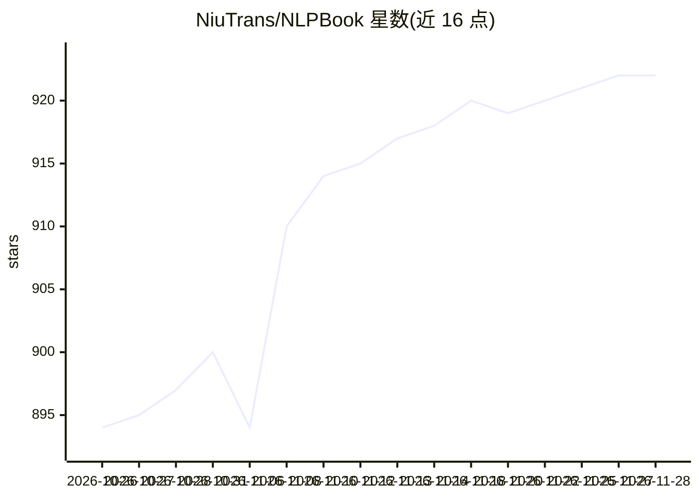

# NiuTrans/NLPBook

⭐ 922 · 推送 2026-11-27 · [GitHub](https://github.com/NiuTrans/NLPBook) · 组织维护 · 中文 README

**面向 NLP/深度学习学习者的神经网络与大模型教材**

由东北大学自然语言处理实验室（肖桐、朱靖波）出版的 NLP 教材，覆盖机器学习基础、词向量、RNN/CNN 序列模型、Seq2Seq、Transformer，以及大模型的预训练、生成、提示、对齐、推理与推理（reasoning）等章节。以章节 PDF 形式在网页上提供，部分章节源自作者已发表文章并补充新内容；提供 BibTeX 引用格式，并有经 LLM 翻译的多语言版本（中、日、法、德、意、葡）。

## 筛选速览

| 维度 | 判定 | 备注 |
|---|---|---|
| AI 角色 | `ai-knowledge` | 知识聚合/清单类 |
| 许可风险 | `none` | — |
| 部署形态 | `None` |  |
| 模型依赖 | — | README 未给出锁定关系 |
| 硬件要求 | — | 无带数字的原话,不猜 |
| 安装摩擦 | `low` | 无编译、无系统依赖或容器化 |
| 成熟度 | — | 结构信号不足 |

## 能力要点

- 12 章覆盖从神经网络基础到大模型推理与推理能力
- 按 Part I 基础/Part II 基本模型/Part III 大模型三部分组织
- 提供完整版 PDF 与分章 PDF 下载
- 提供 BibTeX 引用信息与 LLM 翻译的多语言版本链接

## 适用场景

- 系统学习神经网络与大模型在 NLP 中的应用
- 作为课程教学或科研入门的参考资料
- 阅读 Transformer 与大模型各专题的章节内容

## 场景标签

`教程课程` · 领域:学习与行业

## 证据(README 行号)

> L9: This is a book on neural networks and large language models in NLP. It is intended for anyone interested in NLP and 
> L11: ## Chapters

## 星数曲线

2026-10-26 894 → 2026-11-28 922（+28）

---
*卡片 v1 · prompt 1.4 · 生成 2026-11-28 · 置信度 high · 依据 README sha `7c316feac9c2` · [字段定义](../../DATASET.md)*
