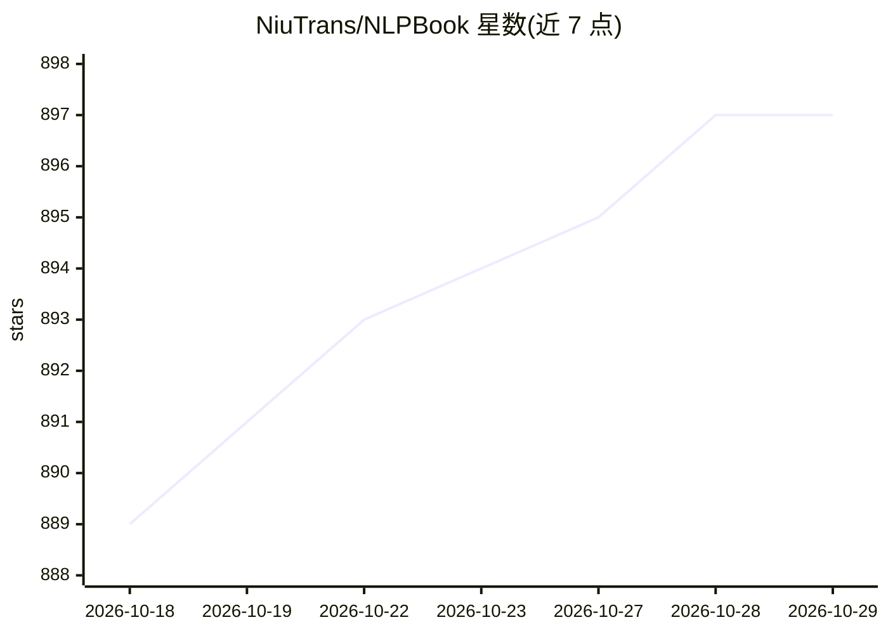

# NiuTrans/NLPBook

⭐ 897 · 推送 2026-10-19 · [GitHub](https://github.com/NiuTrans/NLPBook) · 组织维护 · 中文 README

**面向 NLP 学习者的神经网络与大语言模型书籍（免费 PDF）**

由 Tong Xiao 与 Jingbo Zhu 编写的自然语言处理教材，覆盖机器学习与神经网络基础、词向量、循环/卷积序列模型、Seq2Seq、Transformer，以及大语言模型的预训练、生成、提示、对齐、推理与推理（Reasoning）等 12 章，全部章节以 PDF 提供在线阅读。部分章节源自作者已发表文章并新增内容。全书已用 LLM 翻译为中、日、法、德、意、葡多语言版本，译文存于独立仓库。读者为对 NLP 与深度学习感兴趣的学习者和研究者。

## 筛选速览

| 维度 | 判定 | 备注 |
|---|---|---|
| AI 角色 | `ai-knowledge` | 知识聚合/清单类 |
| 许可风险 | `none` | — |
| 部署形态 | `None` |  |
| 模型依赖 | — | README 未给出锁定关系 |
| 硬件要求 | — | 无带数字的原话,不猜 |
| 安装摩擦 | `low` | 无编译、无系统依赖或容器化 |
| 成熟度 | — | 结构信号不足 |

## 能力要点

- 12 章内容覆盖从神经网络基础到 LLM 推理与 Reasoning
- 全书及各章节提供免费 PDF
- LLM 翻译的多语言版本（中/日/法/德/意/葡）

## 适用场景

- 系统学习 NLP 与深度学习基础
- 学习大语言模型预训练、对齐与推理等主题
- 以非英语语言阅读本书内容

## 场景标签

`教程课程` · 领域:学习与行业

## 证据(README 行号)

> L9: This is a book on neural networks and large language models in NLP. It is intended for anyone interested in NLP and 
> L26:  Part III: Large Language Models

## 星数曲线

2026-10-18 889 → 2026-10-29 897（+8）

---
*卡片 v1 · prompt 1.4 · 生成 2026-10-21 · 置信度 high · 依据 README sha `8cc6e7d5252e` · [字段定义](../../DATASET.md)*
