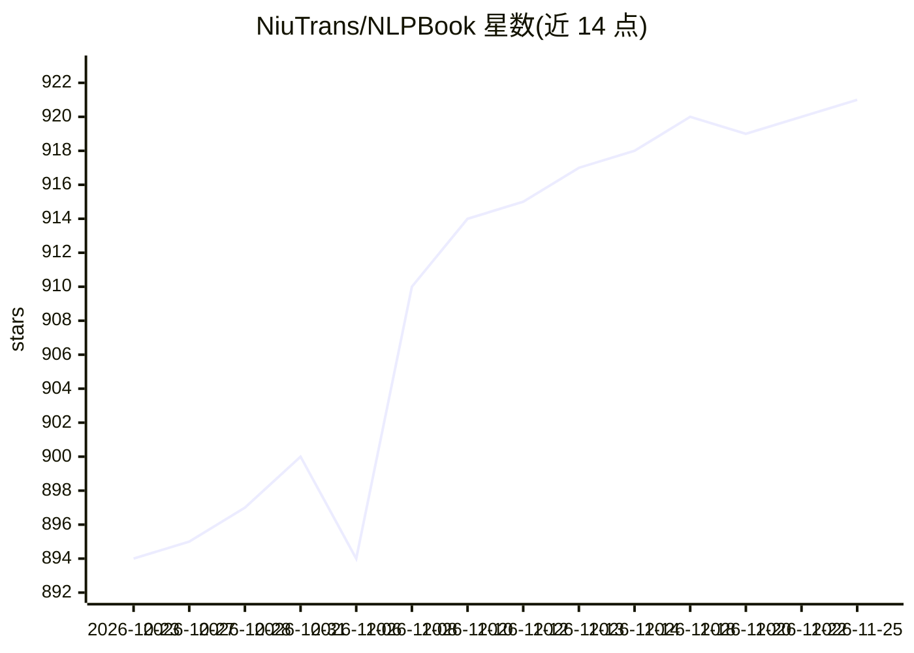

# NiuTrans/NLPBook

⭐ 921 · 推送 2026-11-09 · [GitHub](https://github.com/NiuTrans/NLPBook) · 组织维护 · 中文 README

**面向 NLP 学习者的神经网络与大模型教材**

由东北大学自然语言处理团队教师撰写的开源图书，系统覆盖机器学习基础、词向量、序列模型、Transformer，以及预训练、生成、提示、对齐、推理与推理链等大模型章节，每章提供 PDF，另有完整合订本；部分章节源自已发表文章并补充新内容，书中提供 BibTeX 引用条目，且已用 LLM 翻译为中日法德意葡多语言版本。

## 筛选速览

| 维度 | 判定 | 备注 |
|---|---|---|
| AI 角色 | `ai-knowledge` | 知识聚合/清单类 |
| 许可风险 | `none` | — |
| 部署形态 | `None` |  |
| 模型依赖 | — | README 未给出锁定关系 |
| 硬件要求 | — | 无带数字的原话,不猜 |
| 安装摩擦 | `low` | 无编译、无系统依赖或容器化 |
| 成熟度 | — | 结构信号不足 |

## 能力要点

- 12 章覆盖从机器学习基础到 LLM 对齐/推理
- 每章 PDF 及完整合订本可下载
- LLM 翻译的中日法德意葡多语言版本
- 提供标准 BibTeX 引用条目

## 适用场景

- 系统学习神经网络与大语言模型基础
- 为 NLP 课程挑选讲义章节
- 引用本书作为研究综述参考

## 场景标签

`教程课程` · 领域:学习与行业

## 证据(README 行号)

> L9: This is a book on neural networks and large language models in NLP. It is intended for anyone interested in NLP and 
> L11: ## Chapters
> L26:  Part III: Large Language Models

## 星数曲线

2026-10-23 894 → 2026-11-25 921（+27）

---
*卡片 v1 · prompt 1.4 · 生成 2026-11-24 · 置信度 high · 依据 README sha `2c067f4b4435` · [字段定义](../../DATASET.md)*
