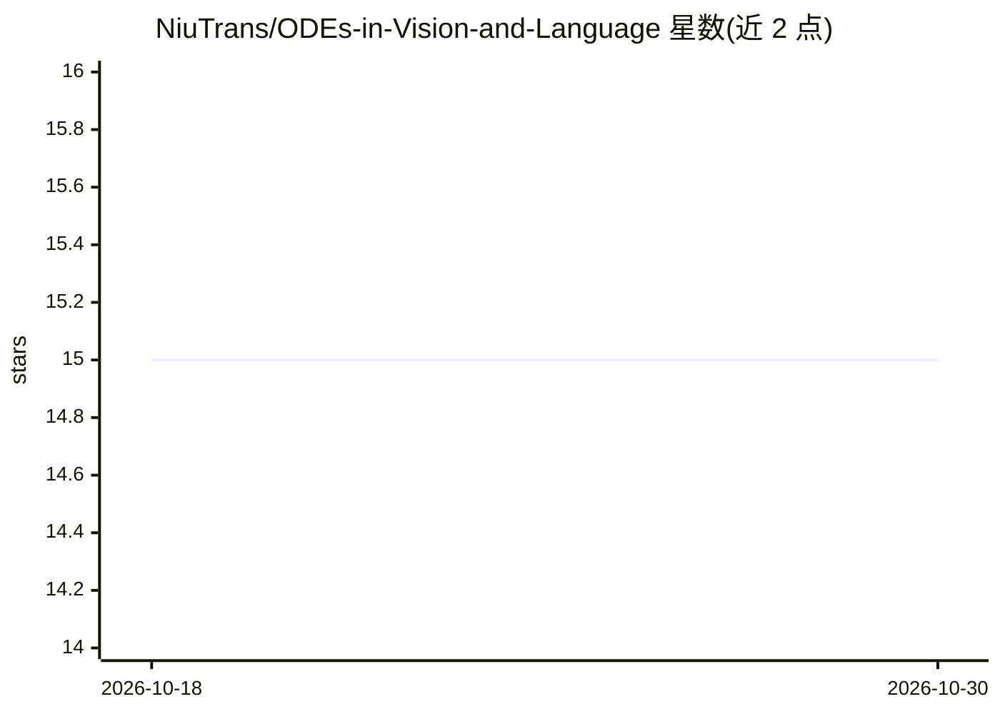

# NiuTrans/ODEs-in-Vision-and-Language

⭐ 15 · HTML · 推送 2026-02-26 · [GitHub](https://github.com/NiuTrans/ODEs-in-Vision-and-Language) · 组织维护 · 中文 README

**介绍 ODE 及其在视觉与语言深度学习中应用的教程文章**

由 NiuTrans 团队（东北大学自然语言处理实验室）发布的综述/教程文章，系统讲解常微分方程（ODE）的数学基础及其在深度学习中的三类应用：将残差网络与 Transformer 解释为 ODE 的离散化、神经 ODE 与流模型、视觉与语言中的扩散模型。提供全文 PDF 与分章 PDF（共 6 章），附 BibTeX 引用条目。面向希望以微分方程视角理解这些模型的学习者与研究者。

## 筛选速览

| 维度 | 判定 | 备注 |
|---|---|---|
| AI 角色 | `ai-knowledge` | 知识聚合/清单类 |
| 许可风险 | `none` | — |
| 部署形态 | `None` |  |
| 模型依赖 | — | README 未给出锁定关系 |
| 硬件要求 | — | 无带数字的原话,不猜 |
| 安装摩擦 | `low` | 无编译、无系统依赖或容器化 |
| 成熟度 | — | 结构信号不足 |

## 能力要点

- 覆盖残差网络/Transformer 的 ODE 离散化视角、神经 ODE 与流、扩散模型三个层次
- 提供全文 PDF 与 6 个独立章节 PDF
- 附 BibTeX 引用条目

## 适用场景

- 系统学习 ODE 视角下的深度学习模型
- 按章节阅读扩散模型在视觉与语言中的应用
- 引用该综述作为学习或研究参考

## 场景标签

`教程课程` · 领域:学习与行业

## 证据(README 行号)

> L9: In the article ***Ordinary Differential Equations in Vision and Language***, we explore how ODEs inspire and constru
> L11: This article seeks to maintain a balance between depth and readability. It provides a systematic explanation of the
> L15: The full version of the article is available here: [[pdf]](https://www.techrxiv.org/doi/full/10.36227/techrxiv.1771

## 星数曲线

2026-10-18 15 → 2026-10-30 15（+0）

---
*卡片 v1 · prompt 1.4 · 生成 2026-10-30 · 置信度 high · 依据 README sha `e5876f3b11a3` · [字段定义](../../DATASET.md)*
