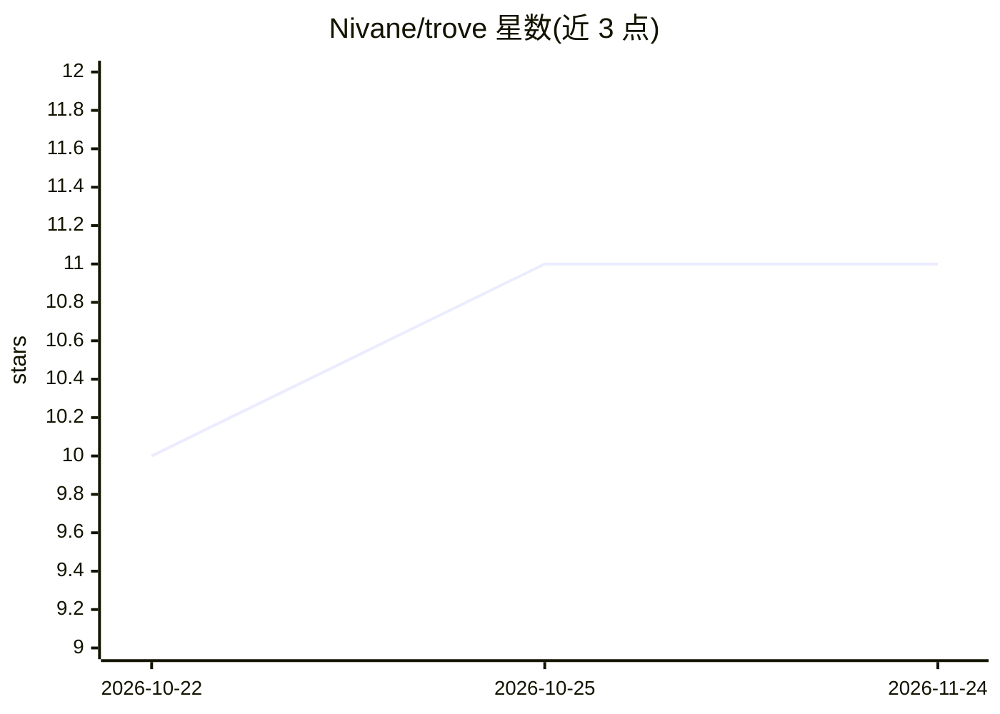

# Nivane/trove

⭐ 10 · Python · Apache-2.0 · 推送 2026-11-23 · [GitHub](https://github.com/Nivane/trove) · [官网](https://nivane.github.io/trove/) · 个人维护 · 中文 README

**面向业务方的自托管 AI 数据决策智能体：问数、分析、决策、行动**

Trove 是开源、自托管的 AI 原生数据决策智能体：自然语言提问生成由真实 SQL 支撑的 Markdown 答案，执行前后均经零 LLM 规则链、AST 防火墙与 EXPLAIN 代价守卫验证，语义模型之外的提问会被拒绝并附模型扩展路径。同一份语义模型还支撑零 LLM 的定时阈值判定与行动提案（人工审批、webhook 外送、效果验收），分析归因用纯 stdlib 统计器械，LLM 只写叙事。系统对业务库保持只读，自动学习内容需管理员确认。

## 筛选速览

| 维度 | 判定 | 备注 |
|---|---|---|
| AI 角色 | `ai-native` | 本体是模型或模型工具 |
| 许可风险 | `permissive` | Apache-2.0 |
| 部署形态 | `self-host` | docker 或自建部署 |
| 模型依赖 | locked-api |  |
| 硬件要求 | — | 无带数字的原话,不猜 |
| 安装摩擦 | `low` | 无编译、无系统依赖或容器化 |
| 成熟度 | — | 结构信号不足 |

## 能力要点

- 语义层（semantics.yml）划定可答边界，覆盖不全时编译骨架 + 生成补缺，结构够不着则拒绝
- 查询管线含意图路由、语义门禁、执行前三门、反思回滚的自校验闭环
- 判定规则零 LLM 定时求值，带季节噪声带与样本不足不硬判的统计诚实
- 只读防火墙、行/列授权、字段脱敏、provider 白名单均由代码强制而非提示词

## 适用场景

- 让业务方用自然语言查询数据库并获得可验证的答案
- 对指标异常做归因分解并解释为什么下降
- 按声明的阈值规则定时判定告警并触发人工审批的行动
- 把 dbt Semantic Layer / Cube 的既有口径导入为语义模型

## 场景标签

`数据分析` · 领域:效率与自动化

## 证据(README 行号)

> L3: **AI Native Data Decision Agent** —— 问数 · 分析 · 决策 · 行动，一条对话链路。
> L22: Trove 是一个**自学习型 AI Native Data Decision Agent（AI 原生的数据决策智能体）**:用自然语言提问,得到由真实 SQL 支撑的 Markdown 答案——执行前与执行后都被验证;当答案只能
> L160: demo 数据源是内置的,但对话仍需要 LLM 凭证(项目根 `.env` 或环境变量,如 `DEEPSEEK_API_KEY`)。没有凭证就不作答——不存在静默的「mock 答案」回退。

## 星数曲线

2026-10-22 10 → 2026-11-24 11（+1）

---
*卡片 v1 · prompt 1.4 · 生成 2026-11-19 · 置信度 high · 依据 README sha `ebc4668926c2` · [字段定义](../../DATASET.md)*
