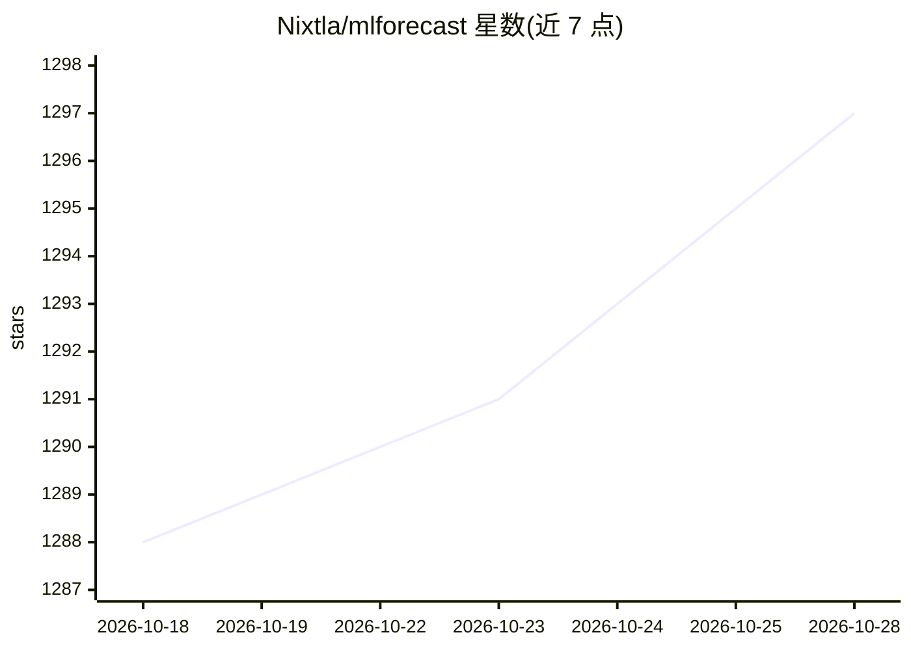

# Nixtla/mlforecast

⭐ 1,299 · Python · Apache-2.0 · 推送 2026-10-28 · [GitHub](https://github.com/Nixtla/mlforecast) · [官网](https://nixtlaverse.nixtla.io/mlforecast) · 组织维护

**面向机器学习模型的时间序列预测框架，支持分布式扩展**

mlforecast 是一个用机器学习模型做时间序列预测的 Python 框架：将滞后特征、滞后变换、日期特征等特征工程自动化，可用任意遵循 scikit-learn API 的回归器（如 LightGBM、LinearRegression）训练数百万条时间序列，采用 .fit/.predict 语法与递归预测策略。兼容 pandas、polars、spark、dask、ray，可借助远程集群扩展到大规模数据；支持 Conformal Prediction 概率预测、外生变量与静态协变量、交叉验证与迁移学习。面向需在生产环境做大规模时序预测的开发者，通过 pip 或 conda-forge 安装。

## 筛选速览

| 维度 | 判定 | 备注 |
|---|---|---|
| AI 角色 | `ai-native` | 本体是模型或模型工具 |
| 许可风险 | `permissive` | Apache-2.0 |
| 部署形态 | `library` | 以包/库形式分发 |
| 模型依赖 | — | README 未给出锁定关系 |
| 硬件要求 | — | 无带数字的原话,不猜 |
| 安装摩擦 | `low` | 无编译、无系统依赖或容器化 |
| 成熟度 | — | 结构信号不足 |

## 能力要点

- 自动化时序特征工程（滞后、滞后变换、日期特征、目标变换）
- 兼容任意 sklearn API 回归器，.fit/.predict 语法
- pandas/polars/spark/dask/ray 后端与分布式集群训练
- Conformal Prediction 概率预测、外生变量与静态协变量支持

## 适用场景

- 用 LightGBM 等模型批量预测海量时间序列
- 在生产环境中做端到端时序训练、评估与选型
- 用电负荷预测等需要预测区间与峰值检测的场景
- 用 Dask/Ray/Spark 集群扩展训练规模

## 场景标签

 · 领域:机器学习/时间序列预测

## 证据(README 行号)

> L15: **mlforecast** is a framework to perform time series forecasting using
> L66: - Fastest implementations of feature engineering for time series

## 星数曲线

2026-10-18 1,288 → 2026-10-28 1,297（+9）

---
*卡片 v1 · prompt 1.4 · 生成 2026-10-21 · 置信度 high · 依据 README sha `128c06cfc7ea` · [字段定义](../../DATASET.md)*
