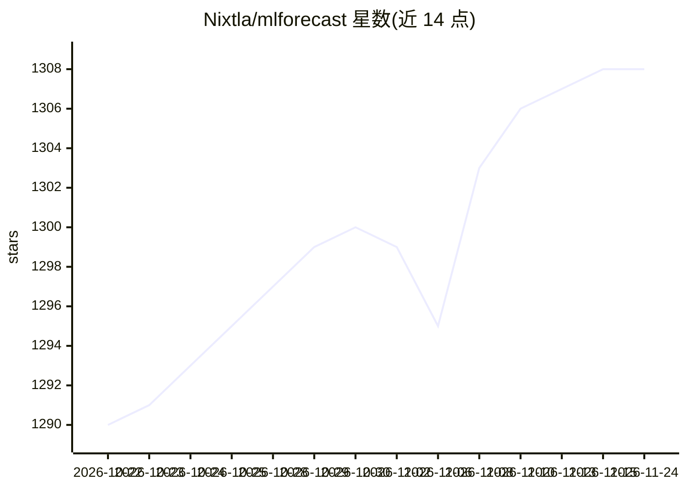

# Nixtla/mlforecast

⭐ 1,308 · Python · Apache-2.0 · 推送 2026-11-19 · [GitHub](https://github.com/Nixtla/mlforecast) · [官网](https://nixtlaverse.nixtla.io/mlforecast) · 组织维护

**面向数据科学者的机器学习时间序列预测框架**

mlforecast 是一个用机器学习模型做时间序列预测的 Python 框架，通过滞后特征、滞后变换与日期特征等特征工程，将任何遵循 scikit-learn fit/predict 接口的回归器（示例使用 LightGBM、LinearRegression）用于拟合大规模时间序列，并支持 Dask、Ray、Spark 集群分布式训练、Conformal Prediction 概率预测区间、外生变量与静态协变量，预测采用递归策略自动更新特征。通过 PyPI 或 conda-forge 安装，文档含端到端教程与多个示例笔记本。

## 筛选速览

| 维度 | 判定 | 备注 |
|---|---|---|
| AI 角色 | `ai-native` | 本体是模型或模型工具 |
| 许可风险 | `permissive` | Apache-2.0 |
| 部署形态 | `library` | 以包/库形式分发 |
| 模型依赖 | — | README 未给出锁定关系 |
| 硬件要求 | — | 无带数字的原话,不猜 |
| 安装摩擦 | `low` | 无编译、无系统依赖或容器化 |
| 成熟度 | — | 结构信号不足 |

## 能力要点

- 兼容 pandas、polars、spark、dask、ray 的数据输入
- Conformal Prediction 生成预测区间
- 支持外生变量与静态协变量
- 可经 Dask/Ray/Spark 集群分布式训练

## 适用场景

- 对海量时间序列批量训练机器学习模型做预测
- 需要预测区间的不确定性估计场景
- 在集群上分布式训练电力负荷等需求预测模型

## 场景标签

 · 领域:数据科学/时间序列预测

## 证据(README 行号)

> L15: **mlforecast** is a framework to perform time series forecasting using
> L70: - Probabilistic Forecasting with Conformal Prediction.
> L106: use a Dask, Ray or Spark cluster to train models at scale.

## 星数曲线

2026-10-22 1,290 → 2026-11-24 1,308（+18）

---
*卡片 v1 · prompt 1.4 · 生成 2026-11-23 · 置信度 high · 依据 README sha `b5f956302de5` · [字段定义](../../DATASET.md)*
