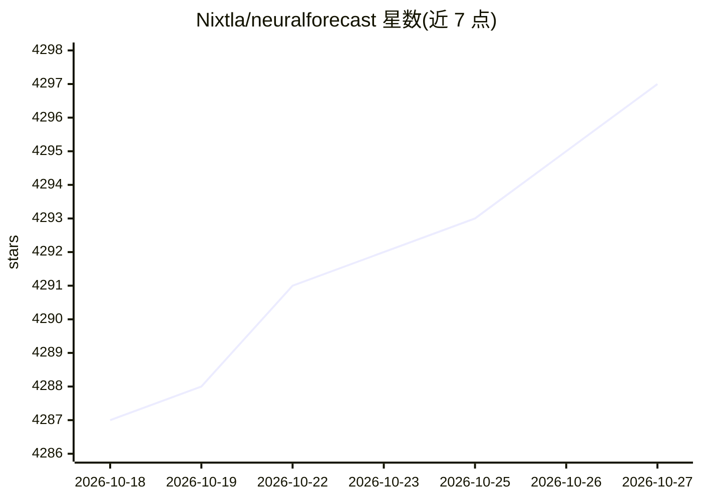

# Nixtla/neuralforecast

⭐ 4,297 · Python · Apache-2.0 · 推送 2026-10-26 · [GitHub](https://github.com/Nixtla/neuralforecast) · [官网](https://nixtlaverse.nixtla.io/neuralforecast) · 组织维护

**面向开发者的神经预测模型库：30+ 时序预测模型统一接口**

Nixtla 维护的 Python 时间序列预测库，实现 30 余种神经预测模型（MLP、LSTM、DeepAR、NBEATS、NHITS、TFT、PatchTST、TimeLLM 等），采用 .fit/.predict 的 sklearn 风格接口。支持外生变量、静态协变量、分位数与参数分布的概率预测、可解释性方法，以及基于 Ray/Optuna 的分布式自动超参调优。提供 NHITS（AAAI 2023）与 NBEATSx 的官方实现；3.3.0 起模型保存默认使用 safetensors 格式，加载不执行产物内代码。

## 筛选速览

| 维度 | 判定 | 备注 |
|---|---|---|
| AI 角色 | `ai-native` | 本体是模型或模型工具 |
| 许可风险 | `permissive` | Apache-2.0 |
| 部署形态 | `library` | 以包/库形式分发 |
| 模型依赖 | — | README 未给出锁定关系 |
| 硬件要求 | — | 无带数字的原话,不猜 |
| 安装摩擦 | `low` | 无编译、无系统依赖或容器化 |
| 成熟度 | — | 结构信号不足 |

## 能力要点

- 30+ 神经预测模型，覆盖 RNN 到 Transformer
- sklearn 风格 .fit/.predict 接口，与 StatsForecast/MLForecast 统一
- 概率预测（分位数损失与参数分布）与可解释性方法
- Ray/Optuna 集成的自动超参调优

## 适用场景

- 用 NBEATS/NHITS 等模型做时间序列预测
- 在预测流程中加入外生变量与概率区间
- 通过 Auto 模型自动搜索超参数

## 场景标签

 · 领域:时间序列预测/机器学习

## 证据(README 行号)

> L18: **NeuralForecast** offers a large collection of neural forecasting models focusing on their performance, usability,
> L57: * Fast and accurate implementations of more than 30 state-of-the-art models. See the entire collection here.

## 星数曲线

2026-10-18 4,287 → 2026-10-27 4,297（+10）

---
*卡片 v1 · prompt 1.4 · 生成 2026-10-20 · 置信度 high · 依据 README sha `7a0b0ee8eab4` · [字段定义](../../DATASET.md)*
