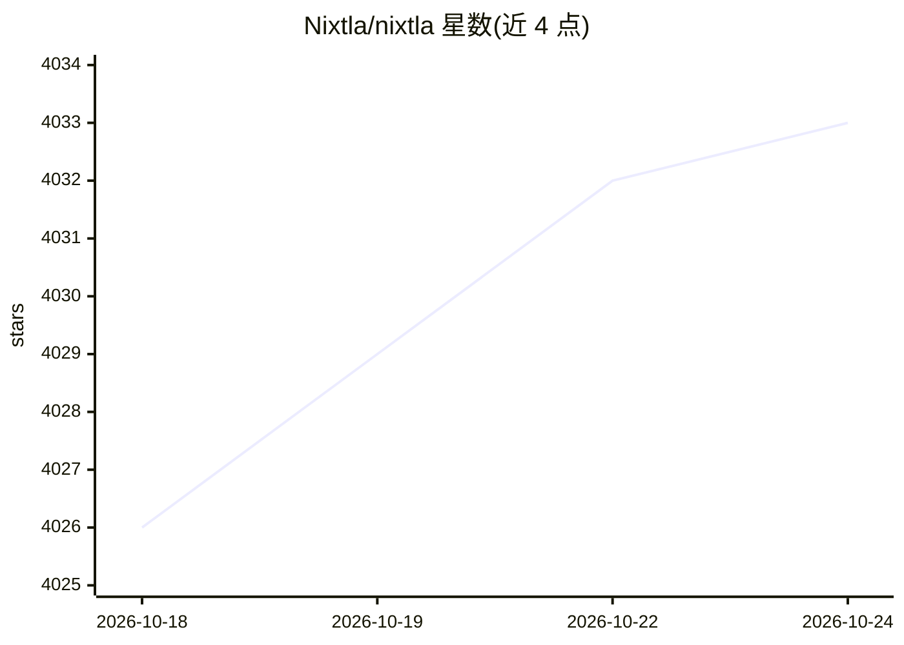

# Nixtla/nixtla

⭐ 4,032 · Jupyter Notebook · NOASSERTION · 推送 2026-10-23 · [GitHub](https://github.com/Nixtla/nixtla) · [官网](https://www.nixtla.io/docs) · 组织维护

**面向开发者的时间序列预测与异常检测基础模型 TimeGPT 的 Python SDK**

Nixtla 官方仓库提供 TimeGPT-2.1 的 SDK（Apache 2.0）：通过 NixtlaClient 调用云端 TimeGPT 模型，实现零样本时序预测与异常检测，支持微调、外生变量、多序列预测、交叉验证、预测区间与不规则时间戳。模型本身闭源，需 API key 才能运行示例；也可自部署或通过 Snowflake 存储过程在自有环境内调用。文档覆盖 Spark/Dask/Ray 分布式扩展教程，API 另支持 JavaScript、Go 等语言。

## 筛选速览

| 维度 | 判定 | 备注 |
|---|---|---|
| AI 角色 | `ai-native` | 本体是模型或模型工具 |
| 许可风险 | `none` | NOASSERTION |
| 部署形态 | `library` | 以包/库形式分发 |
| 模型依赖 | — | README 未给出锁定关系 |
| 硬件要求 | — | 无带数字的原话,不猜 |
| 安装摩擦 | `low` | 无编译、无系统依赖或容器化 |
| 成熟度 | — | 结构信号不足 |

## 能力要点

- 零样本时序预测与异常检测（含在线检测 detect_anomalies_online）
- 支持微调、自定义损失函数、外生变量与预测区间
- Snowflake 部署脚本：在自有数据环境内创建存储过程与 UDTF
- 100B+ 数据点训练，SDK 以 Apache 2.0 开源，模型闭源需 API key

## 适用场景

- 零售、电力、金融、IoT 等领域的时间序列预测
- 时序异常检测与在线监测
- 在 Snowflake 内不迁出数据完成预测任务

## 场景标签

 · 领域:时间序列分析/预测

## 证据(README 行号)

> L14: **TimeGPT** is a production ready, generative pretrained transformer for time series. It's capable of accurately pr
> L30: from nixtla import NixtlaClient
> L178: TimeGPT itself is closed source. The SDK is a client: every forecasting and anomaly detection call is executed by 

## 星数曲线

2026-10-18 4,026 → 2026-10-24 4,033（+7）

---
*卡片 v1 · prompt 1.4 · 生成 2026-10-20 · 置信度 high · 依据 README sha `2a71370b8c80` · [字段定义](../../DATASET.md)*
