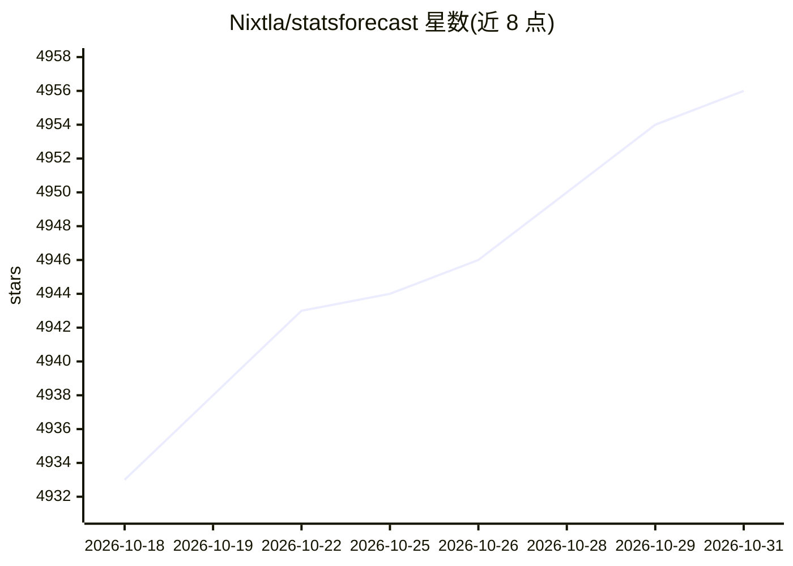

# Nixtla/statsforecast

⭐ 4,956 · Python · Apache-2.0 · 推送 2026-10-29 · [GitHub](https://github.com/Nixtla/statsforecast) · [官网](https://nixtlaverse.nixtla.io/statsforecast) · 组织维护

**单变量时间序列预测库：提供统计与计量经济学模型**

面向生产环境与基准测试的单变量时间序列预测 Python 库，提供 AutoARIMA、AutoETS、AutoCES、Theta 等自动建模工具，以及 ARIMA 家族、指数平滑、GARCH/ARCH、多季节性、稀疏/间歇需求与基线模型等模型集合；支持概率预测、置信区间、外生变量与异常检测，兼容 Spark、Dask、Ray 分布式执行，并采用 sklearn 风格的 .fit/.predict 接口。通过 pip 或 conda 安装。

## 筛选速览

| 维度 | 判定 | 备注 |
|---|---|---|
| AI 角色 | `ai-native` | 本体是模型或模型工具 |
| 许可风险 | `permissive` | Apache-2.0 |
| 部署形态 | `library` | 以包/库形式分发 |
| 模型依赖 | — | README 未给出锁定关系 |
| 硬件要求 | — | 无带数字的原话,不猜 |
| 安装摩擦 | `low` | 无编译、无系统依赖或容器化 |
| 成熟度 | — | 结构信号不足 |

## 能力要点

- 自动预测工具（AutoARIMA/AutoETS/AutoCES/Theta 等）自动搜索参数并选模型
- 概率预测、置信区间与外生变量支持
- 兼容 Spark、Dask、Ray 分布式执行
- 包含 GARCH/ARCH、间歇需求、基线等多类模型

## 适用场景

- 对大量时间序列做生产环境预测
- 为预测任务建立基准模型并评估
- 检测时间序列异常
- 处理带多重季节性或间歇性需求的数据

## 场景标签

 · 领域:时间序列预测/数据科学

## 证据(README 行号)

> L19: **StatsForecast** offers a collection of widely used univariate time series forecasting models, including automatic
> L58: * Fastest and most accurate implementations of `AutoARIMA`, `AutoETS`, `AutoCES`, `MSTL` and `Theta` in Python.

## 星数曲线

2026-10-18 4,933 → 2026-10-31 4,956（+23）

---
*卡片 v1 · prompt 1.4 · 生成 2026-10-20 · 置信度 high · 依据 README sha `9b3caf9b4def` · [字段定义](../../DATASET.md)*
