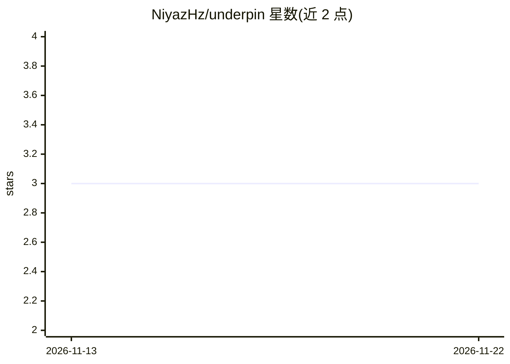

# NiyazHz/underpin

⭐ 3 · Rust · Apache-2.0 · 推送 2026-11-13 · [GitHub](https://github.com/NiyazHz/underpin) · 个人维护

**为 AI agent 记录声明-证据账本并在前提失效时标记待复核项**

面向使用 AI coding agent 的开发者的 Rust CLI 工具：记录每条 agent 结论依赖的命令、来源与其他声明，当证据过期时重新检查，并标记哪些结论变为不可靠。通过 cargo 安装，命令行使用，提供只读本地 web UI（127.0.0.1:7878），可经 MCP 与 hooks 接入 Claude Code。限制包括单用户单机、不自动从文本抽取声明、hook 仅能看到 Bash 命令、audit 默认失败也退出 0（--strict 退出 3）。

## 筛选速览

| 维度 | 判定 | 备注 |
|---|---|---|
| AI 角色 | `ai-ecosystem` | LLM/agent 周边工具 |
| 许可风险 | `permissive` | Apache-2.0 |
| 部署形态 | `library` | 以包/库形式分发 |
| 模型依赖 | — | README 未给出锁定关系 |
| 硬件要求 | — | 无带数字的原话,不猜 |
| 安装摩擦 | `low` | 无编译、无系统依赖或容器化 |
| 成熟度 | `idea` | |

## 能力要点

- 记录 claim 所依赖的证据并在前提变化时标记级联影响
- 通过 MCP 服务器与 hooks 集成 Claude Code，会话开始时总结不再成立的声明
- audit 支持 --strict 退出码用于脚本与 CI
- 内置预构建 web UI，时间线回放声明状态变化

## 适用场景

- 追踪 AI agent 在项目中做出的结论在代码变更后哪些需要重查
- 在 CI 中用 --strict 模式对失效声明做门禁
- 复核 agent 会话开始前哪些既有事实已不再成立

## 场景标签

`Agent 记忆` · 领域:Agent 开发

## 证据(README 行号)

> L10: the code or a source changes, nobody notices which conclusions just went stale. **underpin is a ledger for those cl
> L12: conclusions are shaky when a premise breaks. It works from the command line and plugs into Claude Code via MCP and 
> L51: With Claude Code, `underpin init --claude --yes` in your project registers the MCP server and the hooks (project-lo

## 星数曲线

2026-11-13 3 → 2026-11-22 3（+0）

---
*卡片 v1 · prompt 1.4 · 生成 2026-11-22 · 置信度 high · 依据 README sha `a63fcdbf221d` · [字段定义](../../DATASET.md)*
