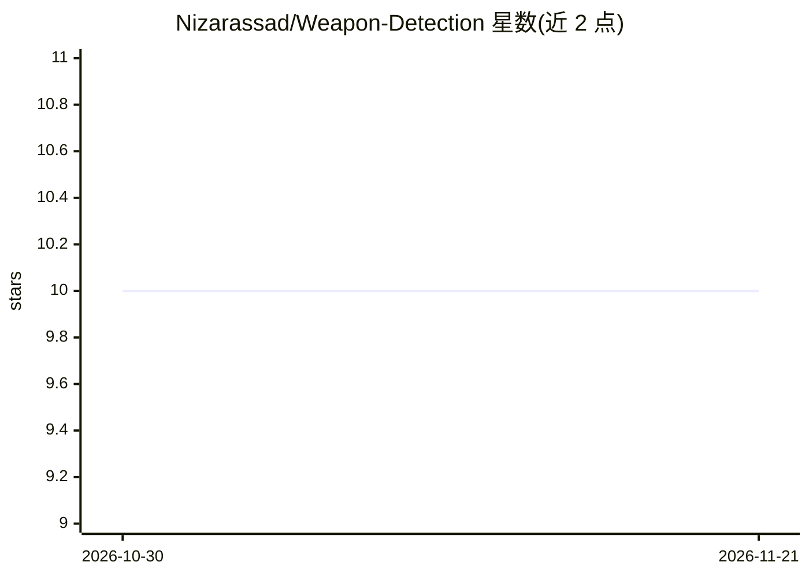

# Nizarassad/Weapon-Detection

⭐ 10 · Jupyter Notebook · 推送 2026-08-12 · [GitHub](https://github.com/Nizarassad/Weapon-Detection) · 个人维护

**面向科研者的枪支检测研究工件：对比四种深度学习模型**

MSc 数据科学项目的公开研究工件，对比 YOLOv5s、YOLOv7、YOLOv8s 与 VGG16 四种方法在 CCTV 风格图像上的枪支检测效果，附原始训练/评估 notebooks、提交的项目报告、外部数据集与训练权重链接及定性未见图像测试存档。2023 年完成，未经同行评审，也非安全认证的检测系统；报告未保留足够硬件与计时细节，历史结果不可作为通用基准，定性评估中观察到空手误检等假阳性。

## 筛选速览

| 维度 | 判定 | 备注 |
|---|---|---|
| AI 角色 | `ai-native` | 本体是模型或模型工具 |
| 许可风险 | `none` | — |
| 部署形态 | `None` |  |
| 模型依赖 | — | README 未给出锁定关系 |
| 硬件要求 | — | 无带数字的原话,不猜 |
| 安装摩擦 | `low` | 无编译、无系统依赖或容器化 |
| 成熟度 | `idea` | |

## 能力要点

- 对比 YOLOv5s/YOLOv7/YOLOv8s/VGG16 四种检测方法并给出历史指标表
- 包含原始训练与评估 Jupyter notebooks 及 MSc 项目报告
- 数据集托管于 Roboflow Universe，训练权重托管于 Google Drive
- 附 REPRODUCIBILITY.md、ETHICS.md 与权利/许可说明文档

## 适用场景

- 复现枪支检测的迁移学习与微调实验
- 作为计算机视觉课程或学位项目的参考工件
- 在定性层面检查模型对未见图像的检出表现

## 场景标签

`科研工具` `目标检测` `微调` · 领域:学习与行业

## 证据(README 行号)

> L5: Research software and the supporting MSc Data Science project artifact for comparing four deep-learning approaches t
> L11: The project investigates whether transfer learning and fine-tuning can support gun detection in CCTV-style imagery.

## 星数曲线

2026-10-30 10 → 2026-11-21 10（+0）

---
*卡片 v1 · prompt 1.4 · 生成 2026-11-20 · 置信度 high · 依据 README sha `8e4c93749fde` · [字段定义](../../DATASET.md)*
