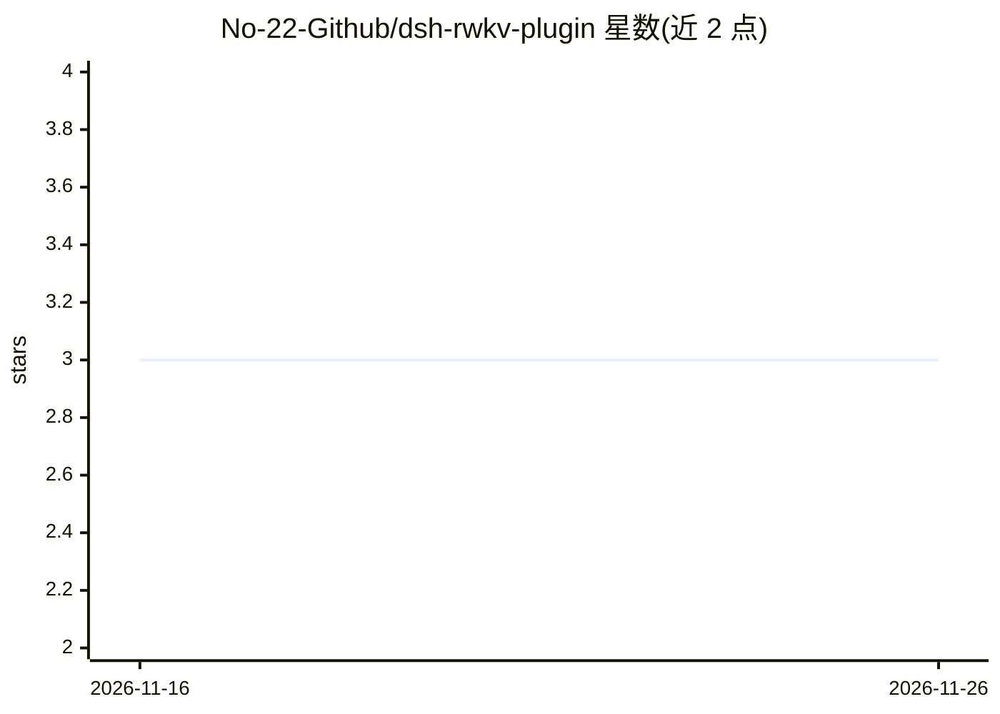

# No-22-Github/dsh-rwkv-plugin

⭐ 3 · TypeScript · MIT · 推送 2026-11-25 · [GitHub](https://github.com/No-22-Github/dsh-rwkv-plugin) · 个人维护 · 中文 README

**把 RWKV-7 G1 接入 DeepSeek Harness 的模型提供方插件**

DeepSeek Harness（DSH）桌面版的插件：注册 `rwkv` 模型提供方，让 RWKV-7 G1 作为主 Agent 或供 DeepSeek 主 Agent 调用的子 Agent。因 RWKV 只续写文本，插件在对话接口与整段文本之间转换，并实现续写式 agent 循环、输出解析容错、重复调用拦截与 15 步强制收尾等兜底机制。会话、工具、沙箱、审批归 DSH 管理，插件不存状态，每次生成的提示词与原始输出记录在插件轨迹中可查。

## 筛选速览

| 维度 | 判定 | 备注 |
|---|---|---|
| AI 角色 | `ai-ecosystem` | LLM/agent 周边工具 |
| 许可风险 | `permissive` | MIT |
| 部署形态 | `None` |  |
| 模型依赖 | — | README 未给出锁定关系 |
| 硬件要求 | — | 无带数字的原话,不猜 |
| 安装摩擦 | `low` | 无编译、无系统依赖或容器化 |
| 成熟度 | — | 结构信号不足 |

## 能力要点

- 续写式 agent 循环：解析容错、重复调用拦截、强制收尾等多层兜底
- 提供 bash/read/edit_lines/web_search 等 8 个工具，上下文管理支持 full/worklist/relay 三种模式
- 设置页可调模型、state/adapter、运行参数与兜底开关，保存即生效
- 轨迹记录每次生成的提示词与原始输出，并有关闭兜底测模型本身的开关

## 适用场景

- 在 DSH 中把 RWKV-7 G1 当作主 Agent 跑 agent 任务
- 让 RWKV 作为子 Agent 供 DeepSeek 主 Agent 调用
- 测试 RWKV 模型在无兜底条件下的原样 agent 能力

## 场景标签

`Agent 框架` · 领域:Agent 开发

## 证据(README 行号)

> L5: - 注册一个 `rwkv` 模型提供方：RWKV 当主 Agent，或作为子 Agent 给 DeepSeek 主 Agent 调用。
> L7: - 会话、工具、沙箱、审批仍归 DSH 管；插件不存状态。

## 星数曲线

2026-11-16 3 → 2026-11-26 3（+0）

---
*卡片 v1 · prompt 1.4 · 生成 2026-11-22 · 置信度 high · 依据 README sha `e555e85b56eb` · [字段定义](../../DATASET.md)*
