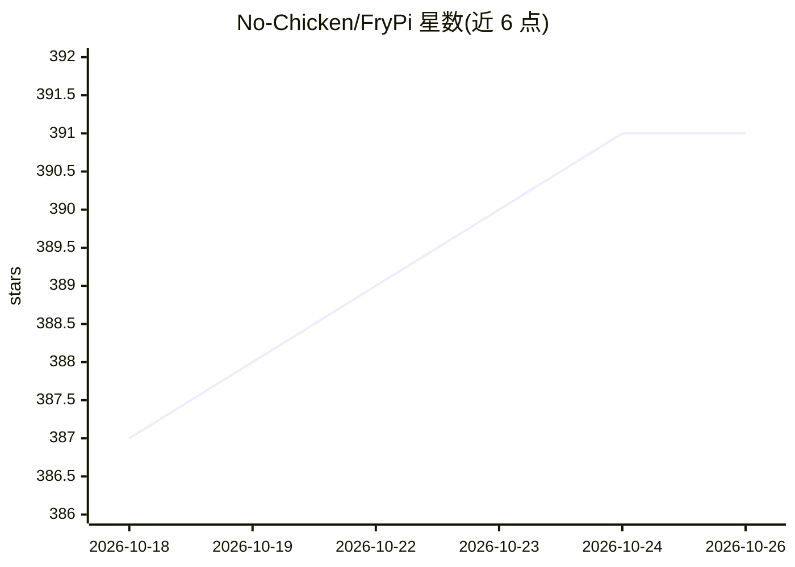

# No-Chicken/FryPi

⭐ 391 · C · GPL-3.0 · 推送 2026-05-26 · [GitHub](https://github.com/No-Chicken/FryPi) · 个人维护 · 中文 README

**基于 STM32F411RET6 的迷你开发板，面向 AI 与 UI 嵌入式开发**

硬件开源的 STM32F411RET6 开发板（Cortex-M4，512KB Flash，100MHz），板型小于手掌，可外焊 SPI Flash 并留有扩展板接口（如 Cam 扩展板）。例程分基础（GPIO/USART/LCD 等）与高级两类，高级例程包含 CubeAI 使用、手写数字识别、热成像手势识别、Simulink 在环开发、LVGL 智能手表、OV2640 摄像头识别等。面向嵌入式初学者与进阶开发者，起因是 OV-Watch 智能手表项目复刻焊接困难。提供双 TypeC 与单 TypeC 两种 Core 板版本，配套说明手册与 QQ 交流群。

## 筛选速览

| 维度 | 判定 | 备注 |
|---|---|---|
| AI 角色 | `ai-enhanced` | 去掉 AI 部分产品仍成立 |
| 许可风险 | `viral` | GPL-3.0 |
| 部署形态 | `None` |  |
| 模型依赖 | — | README 未给出锁定关系 |
| 硬件要求 | — | 无带数字的原话,不猜 |
| 安装摩擦 | `low` | 无编译、无系统依赖或容器化 |
| 成熟度 | — | 结构信号不足 |

## 能力要点

- STM32F411RET6（Cortex-M4+DSP+FPU，512KB Flash，100MHz）硬件开源设计
- 高级例程覆盖 CubeAI、手写数字识别、热成像手势识别、LVGL 智能手表
- Simulink 在环开发与 Matlab 联合开发例程
- 支持外接扩展板（Cam 扩展板等）与外置 SPI Flash

## 适用场景

- 在 STM32 上学习和部署小型 AI 模型（手写数字/手势识别）
- 做 LVGL UI 或智能手表类嵌入式项目
- 毕业设计与数字电源控制板等项目原型

## 场景标签

`教程课程` · 领域:学习与行业

## 证据(README 行号)

> L17: 这是一个比手掌还小的STM32F411RET6迷你开发板，可以用于AI开发，UI开发，数字电源控制板等等，甚至可以拿去用于你的毕业设计和其他相关的项目。
> L31:  - 例程丰富：高级例程：智能手表，热成像手势识别，手写数字识别，与matlab联合开发，simulink在环开发等等.

## 星数曲线

2026-10-18 387 → 2026-10-26 391（+4）

---
*卡片 v1 · prompt 1.4 · 生成 2026-10-21 · 置信度 high · 依据 README sha `b6bf2ce9de43` · [字段定义](../../DATASET.md)*
