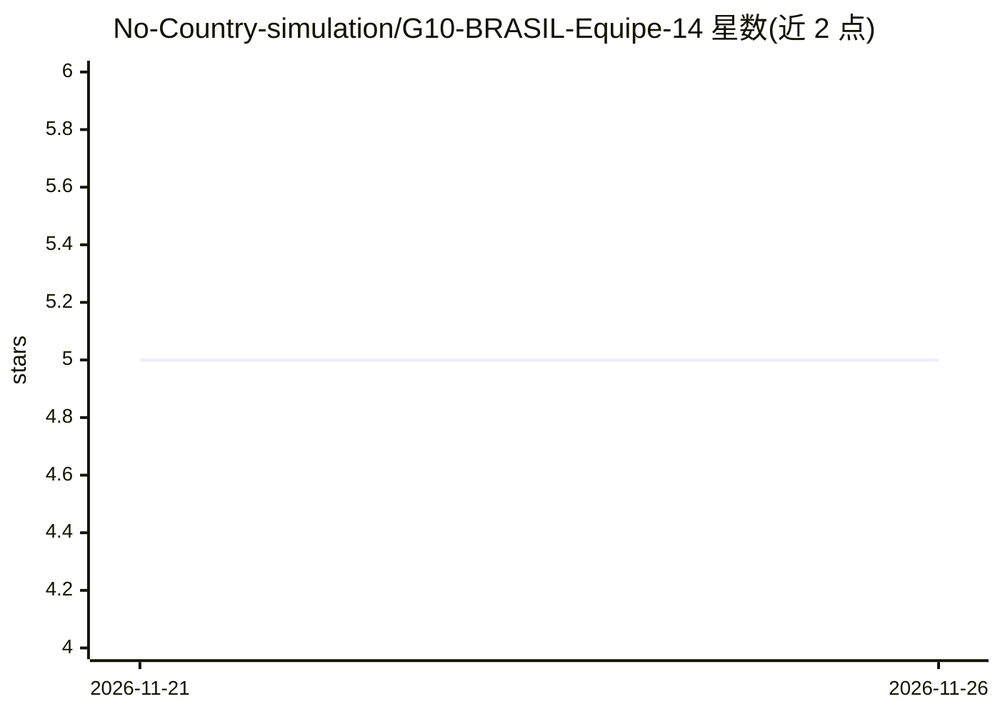

# No-Country-simulation/G10-BRASIL-Equipe-14

⭐ 5 · Python · MIT · 推送 2026-11-23 · [GitHub](https://github.com/No-Country-simulation/G10-BRASIL-Equipe-14) · 组织维护

**社区讨论转结构化内容的 AI 自动化流水线工具**

面向技术社区的自动化生态系统：通过 n8n 编排流水线，摄取社区讨论与提问数据，经 AI 模型进行分拣与内容生成，配合 Streamlit 面板做人工审核（Human-in-the-Loop），最终将结构化内容包持久化到 Oracle Cloud 对象存储。数据层使用 DuckDB/Pandas/JSON Schema，提供输入契约校验脚本与 pytest 测试套件。为 Oracle Next Education G10 巴西黑客松的 MVP 项目，部分模块仍处于开发中。

## 筛选速览

| 维度 | 判定 | 备注 |
|---|---|---|
| AI 角色 | `ai-native` | 本体是模型或模型工具 |
| 许可风险 | `permissive` | MIT |
| 部署形态 | `self-host` | docker 或自建部署 |
| 模型依赖 | local-ok | 支持本地模型 |
| 硬件要求 | — | 无带数字的原话,不猜 |
| 安装摩擦 | `low` | 无编译、无系统依赖或容器化 |
| 成熟度 | `idea` | |

## 能力要点

- n8n 编排的摄取-分拣-生成-持久化流水线
- Streamlit 人工审核界面（Human-in-the-Loop）
- 支持 Gemini API / Groq / Ollama 作为模型后端
- JSON Schema 输入契约校验与 pytest 测试套件

## 适用场景

- 把社区讨论整理成教育与营销内容包
- AI 分拣加人工审核的内容生产流程
- 云端对象存储归档结构化内容

## 场景标签

`工作流自动化` `AI 写作` · 领域:效率与自动化

## 证据(README 行号)

> L7: O **CommunityLab** é um ecossistema inteligente de automação projetado para transformar o fluxo contínuo de discussõ
> L17: Desenvolver um MVP funcional capaz de ingerir dados de comunidades, orquestrar triagens com IA, permitir curadoria 
> L25: * **Modelos de IA:** Google Gemini API (Camada Gratuita) / Groq ou Ollama

## 星数曲线

2026-11-21 5 → 2026-11-26 5（+0）

---
*卡片 v1 · prompt 1.4 · 生成 2026-11-21 · 置信度 mid · 依据 README sha `e59811e4ef72` · [字段定义](../../DATASET.md)*
