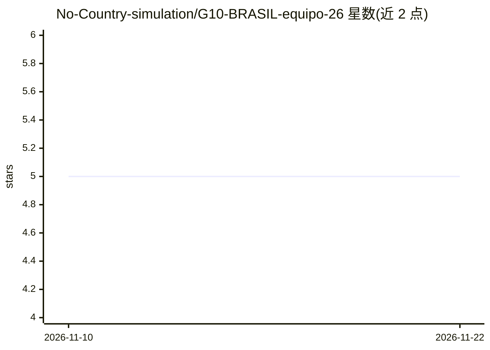

# No-Country-simulation/G10-BRASIL-equipo-26

⭐ 5 · Python · MIT · 推送 2026-11-20 · [GitHub](https://github.com/No-Country-simulation/G10-BRASIL-equipo-26) · [官网](https://mentoria-tech-ai.streamlit.app) · 组织维护

**把技术文档转成个性化学习材料的 RAG 教育平台**

Hackathon ONE G10 的参赛项目：接收 PDF/Markdown/TXT 技术文档，通过 RAG 管道按学习者画像（初学者/Jr/Pleno/Tech Lead/高管）、教学格式（教程/闪卡/测验/TL;DR 等）和深度生成结构化学习内容，当前仅支持 PT-BR。每次生成引用原文页码与 chunk，并在接受回答前做确定性引用校验。提供 Streamlit 在线 MVP 与 FastAPI 后端，输出持久化到 OCI Object Storage，LLM 使用 Groq 主通道与 Gemini fallback。

## 筛选速览

| 维度 | 判定 | 备注 |
|---|---|---|
| AI 角色 | `ai-native` | 本体是模型或模型工具 |
| 许可风险 | `permissive` | MIT |
| 部署形态 | `None` |  |
| 模型依赖 | locked-api |  |
| 硬件要求 | — | 无带数字的原话,不猜 |
| 安装摩擦 | `low` | 无编译、无系统依赖或容器化 |
| 成熟度 | — | 结构信号不足 |

## 能力要点

- RAG 管道经 200 组合基准调参（chunk_size=2000, overlap=200, K=10）
- 生成内容引用真实页码/chunk 并做确定性来源校验
- Groq 主模型 + Google Gemini fallback 与 API key 池轮转
- SQLite 零 PII 持久化 + OCI Always Free 私有桶存储

## 适用场景

- 把密集技术文档转成按水平分层的教程和测验
- 为学习材料生成可溯源到原文页码的闪卡
- 需要 TL;DR 和摘要的技术速览

## 场景标签

`RAG` `AI 写作` · 领域:内容生成

## 证据(README 行号)

> L23: A plataforma recebe uma documentação técnica (manual, guia de nuvem, artigo) e a transforma em material de estudo e
> L50: Todo item gerado cita **páginas e chunks reais** do documento, e o sistema verifica essas referências de forma dete
> L72: |**LLMs**|Groq `openai/gpt-oss-120b` (principal) · Google Gemini (fallback + embeddings/reranking)|

## 星数曲线

2026-11-10 5 → 2026-11-22 5（+0）

---
*卡片 v1 · prompt 1.4 · 生成 2026-11-21 · 置信度 high · 依据 README sha `1cb31bd22849` · [字段定义](../../DATASET.md)*
