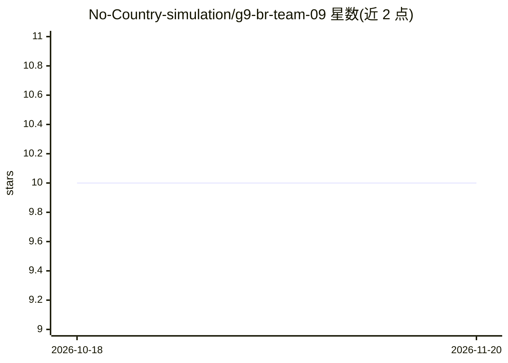

# No-Country-simulation/g9-br-team-09

⭐ 10 · Jupyter Notebook · 推送 2026-08-18 · [GitHub](https://github.com/No-Country-simulation/g9-br-team-09) · [官网](https://energiai.vercel.app) · 组织维护

**全栈能源消费分析 MVP：五项输入输出效率分类与建议**

Hackathon ONE G9-BR 团队交付的全栈 MVP：用户填写五项用电特征，Spring Boot 公共 API 校验后调用 FastAPI 内部推理服务，由冻结的 Random Forest 模型（含等秩校准）输出效率分类、低效指数、概率、月成本估算与建议，并持久化到 Oracle Autonomous Database，提供历史、详情与仪表盘。FastAPI 不可用时切换到 Spring Boot 内的规则兜底。技术栈为 React+TypeScript、Java 21、Python 3.12、Docker Compose、Terraform，部署于 OCI/Vercel/Render。模型基于 5000 条合成数据训练，README 声明指标不代表真实数据表现。

## 筛选速览

| 维度 | 判定 | 备注 |
|---|---|---|
| AI 角色 | `ai-native` | 本体是模型或模型工具 |
| 许可风险 | `none` | — |
| 部署形态 | `library` | 以包/库形式分发 |
| 模型依赖 | — | README 未给出锁定关系 |
| 硬件要求 | — | 无带数字的原话,不猜 |
| 安装摩擦 | `medium` | 含编译或系统依赖之一 |
| 成熟度 | — | 结构信号不足 |

## 能力要点

- Random Forest + 等秩校准的冻结推理管线（合成数据 5000 条，holdout 一次评估）
- ML 优先 + 规则兜底（RULE_BASED_FALLBACK）保障分析可用性
- JWT 认证、历史查询、分页列表与用户仪表盘
- Swagger/OpenAPI 文档、CI 与 Docker Compose 打包

## 适用场景

- 为家庭或小型场所输入用电特征获取效率分类与建议
- 查看个人历史分析记录与汇总指标仪表盘
- 作为全栈 + ML + 云部署的项目参考结构

## 场景标签

`数据分析` · 领域:效率与自动化

## 证据(README 行号)

> L19: > **MVP full stack de análise energética** que transforma cinco informações simples de consumo em uma classificação
> L67: 3. envia as cinco features para a API interna de Machine Learning;
> L83: |🤖 **Machine Learning**|Inferência com o modelo energético V2|

## 星数曲线

2026-10-18 10 → 2026-11-20 10（+0）

---
*卡片 v1 · prompt 1.4 · 生成 2026-11-20 · 置信度 high · 依据 README sha `9c51fe9be6ca` · [字段定义](../../DATASET.md)*
