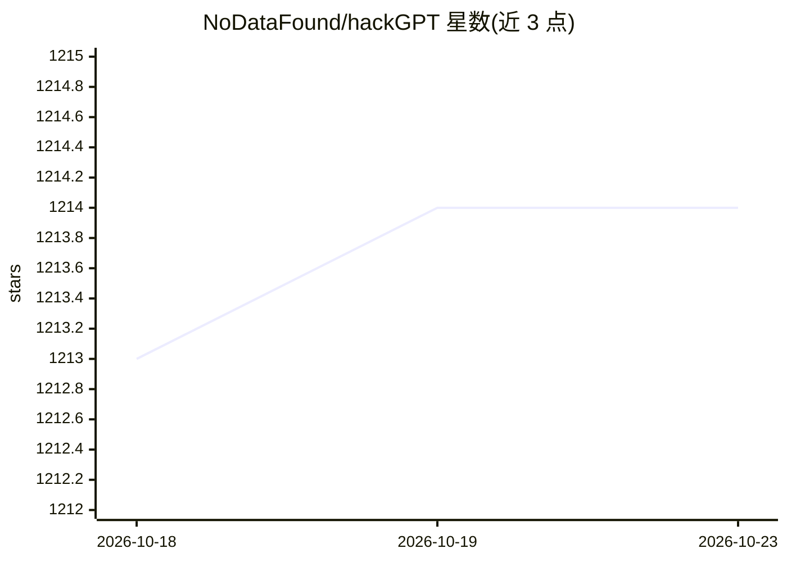

# NoDataFound/hackGPT

⭐ 1,214 · Jupyter Notebook · 推送 2026-08-12 · [GitHub](https://github.com/NoDataFound/hackGPT) · [官网](http://hackGPT.com) · 个人维护

**用 ChatGPT 做安全攻防实验的 Python/Jupyter 工具**

面向安全研究者的 ChatGPT 应用集合：通过 Jupyter Notebook 或 Python 脚本调用 OpenAI API，进行恶意软件样本分析、CVE 利用生成、JSON 威胁数据解析、JIRA 缺陷自动修复提交、Siri 集成与自源码打印等实验。安装方式为 git clone 源码、pip 安装依赖并在 .env 配置 OpenAI API key，支持 Google Colab 与移动端运行，提供在线演示站点 hackgpt.com。

## 筛选速览

| 维度 | 判定 | 备注 |
|---|---|---|
| AI 角色 | `ai-native` | 本体是模型或模型工具 |
| 许可风险 | `none` | — |
| 部署形态 | `library` | 以包/库形式分发 |
| 模型依赖 | — | README 未给出锁定关系 |
| 硬件要求 | — | 无带数字的原话,不猜 |
| 安装摩擦 | `low` | 无编译、无系统依赖或容器化 |
| 成熟度 | — | 结构信号不足 |

## 能力要点

- 自动化恶意软件样本与源码的批量分析（PwnAI.py / PwnAI_bulk.py）
- 自动解析 SecurityScorecard ASI API 的 JSON 威胁数据
- 按 type=bug 查找 JIRA 问题并生成修复回帖
- 支持本地 Jupyter、Google Colab 与 Siri 多种运行途径

## 适用场景

- 批量分析恶意软件样本或可疑源码
- 自动解析网络防御工具输出的威胁数据
- 用 AI 辅助生成 CVE 利用与防护测试

## 场景标签

`网络安全` · 领域:学习与行业

## 证据(README 行号)

> L37: `Automate the parsing and analysis of json threat data from CyberDefense tools like my SecurityScorecard ASI API to
> L97: `Configure .env with your OpenAI API key(notebook will help you)`

## 星数曲线

2026-10-18 1,213 → 2026-10-23 1,214（+1）

---
*卡片 v1 · prompt 1.4 · 生成 2026-10-21 · 置信度 mid · 依据 README sha `7623716d762b` · [字段定义](../../DATASET.md)*
