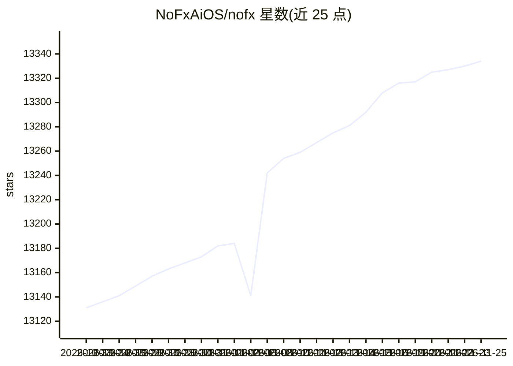

# NoFxAiOS/nofx

⭐ 13,334 · Go · AGPL-3.0 · 推送 2026-11-04 · [GitHub](https://github.com/NoFxAiOS/nofx) · [官网](https://vergex.trade/explore) · 组织维护 · 中文 README

**自托管的 AI 交易终端：辅助规划并执行加密交易**

NOFX 是一个可自托管的开源交易系统，通过 Docker 或源码在本机运行，前端为浏览器界面。提供两种模式：Frontier 由 AI 参与生成入场方案（市价、限价、加权阶梯、TWAP），用户在图表上比较并逐笔批准后执行；Autopilot 按配置的模型、交易所账户与策略持续自动交易。模型与付费数据访问经 Claw402 通道结算，交易所凭证本地加密存储，模型不接收私钥。支持 Binance、Hyperliquid、OKX、Bitget 等 9 家交易所。

## 筛选速览

| 维度 | 判定 | 备注 |
|---|---|---|
| AI 角色 | `ai-native` | 本体是模型或模型工具 |
| 许可风险 | `viral` | AGPL-3.0 |
| 部署形态 | `self-host` | docker 或自建部署 |
| 模型依赖 | — | README 未给出锁定关系 |
| 硬件要求 | — | 无带数字的原话,不猜 |
| 安装摩擦 | `low` | 无编译、无系统依赖或容器化 |
| 成熟度 | — | 结构信号不足 |

## 能力要点

- Frontier 交互式下单：AI 生成入场方案，用户批准后执行
- Autopilot 自动交易：配置模型、账户与策略后持续运行
- 支持 Binance USDT 永续、Hyperliquid、OKX、Bitget 等 9 家交易所
- 订单对账机制：不确定提交结果与交易所核对而非重复提交

## 适用场景

- 在图表上比较多种入场方案后再手动批准下单
- 配置策略让 AI 交易员持续自动运行
- 本地部署并管理多交易所的交易账户

## 场景标签

`金融量化` · 领域:学习与行业

## 证据(README 行号)

> L20: NOFX is an open-source trading system you run on your own machine. Use **Frontier** to work through a trade with AI
> L44: 3. **Review and trade.** Select a plan to focus the chart. Review the current account and order details, then expli
> L60: For strategies you want to run continuously, configure a trader with a model, exchange account and strategy. Autopi

## 星数曲线

2026-10-23 13,131 → 2026-11-25 13,334（+203）

---
*卡片 v1 · prompt 1.4 · 生成 2026-11-22 · 置信度 high · 依据 README sha `badbce7e6a08` · [字段定义](../../DATASET.md)*
