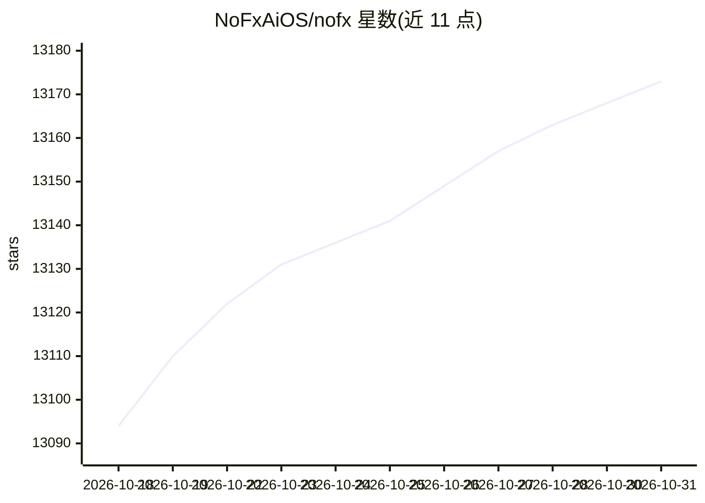

# NoFxAiOS/nofx

⭐ 13,173 · Go · AGPL-3.0 · 推送 2026-10-21 · [GitHub](https://github.com/NoFxAiOS/nofx) · [官网](https://vergex.trade/explore) · 组织维护 · 中文 README

**自托管 AI 交易系统：人审下单与连续策略执行**

运行在用户本机的开源交易系统（AGPL-3.0，Go/Node.js 构建，Docker Compose 部署，浏览器访问）。提供两种模式：Frontier 让用户与 AI 协作制定入场计划（市价/限价/加权阶梯/TWAP），在图表上比较后人工批准下单；Autopilot 配置模型、交易所账户与策略后连续运行并自动下单。通过 Claw402 接入模型，费用以 Base 链 USDC 结算；支持 Binance、Hyperliquid、OKX、Bitget 等交易所。模型不接收钱包私钥或交易所凭证；交易资金与 AI 费用钱包分离。

## 筛选速览

| 维度 | 判定 | 备注 |
|---|---|---|
| AI 角色 | `ai-native` | 本体是模型或模型工具 |
| 许可风险 | `viral` | AGPL-3.0 |
| 部署形态 | `self-host` | docker 或自建部署 |
| 模型依赖 | — | README 未给出锁定关系 |
| 硬件要求 | — | 无带数字的原话,不猜 |
| 安装摩擦 | `low` | 无编译、无系统依赖或容器化 |
| 成熟度 | — | 结构信号不足 |

## 能力要点

- Frontier 模式：AI 生成四种入场计划，用户审查后显式批准执行
- Autopilot 模式：配置模型与策略后连续运行，Dashboard 展示持仓与决策历史
- 通过 Claw402 访问多个模型，费用以 Base 链 USDC 结算
- 交易所凭证本地加密存储，模型提示中不包含私钥与凭证

## 适用场景

- 在图表上与 AI 协作比较入场方案并人工批准下单
- 配置策略后让 Autopilot 连续执行交易
- 在同一界面管理多个交易所账户的持仓与订单

## 场景标签

`金融量化` · 领域:学习与行业

## 证据(README 行号)

> L20: NOFX is an open-source trading system you run on your own machine. Use **Frontier** to work through a trade with AI
> L143: Frontier and Autopilot reuse models configured in NOFX. Claw402 provides access to multiple models with usage sett

## 星数曲线

2026-10-18 13,094 → 2026-10-31 13,173（+79）

---
*卡片 v1 · prompt 1.4 · 生成 2026-10-20 · 置信度 high · 依据 README sha `46b8c9fea851` · [字段定义](../../DATASET.md)*
