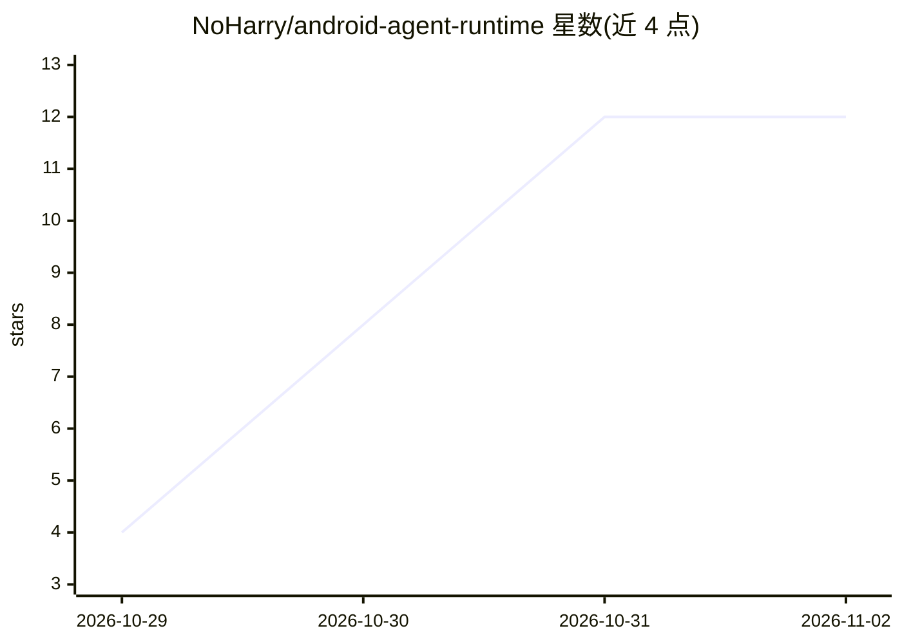

# NoHarry/android-agent-runtime

⭐ 12 · Kotlin · MIT · 推送 2026-10-28 · [GitHub](https://github.com/NoHarry/android-agent-runtime) · 个人维护 · 中文 README

**可嵌入 Android/JVM 的 agent 运行时：自带模型即用的完整代理循环**

面向 Android 应用与 JVM 项目的嵌入式 agent 运行时（agent harness）：在应用进程内执行完整 agent 循环，包含沙盒化的虚拟文件系统工作区、Kotlin 函数工具与 MCP 远程工具、按需加载的 skills、子代理委派、工具调用前后的 hooks 与策略引擎，以及基于事件日志的可恢复会话。模型侧接入任意 OpenAI 或 Anthropic 兼容模型。以 Gradle/Maven Central 工件分发，要求 Kotlin 2.0+、JDK 17、Android minSdk 23。项目处于 0.x 阶段，公开 API 未冻结。

## 筛选速览

| 维度 | 判定 | 备注 |
|---|---|---|
| AI 角色 | `ai-ecosystem` | LLM/agent 周边工具 |
| 许可风险 | `permissive` | MIT |
| 部署形态 | `None` |  |
| 模型依赖 | — | README 未给出锁定关系 |
| 硬件要求 | — | 无带数字的原话,不猜 |
| 安装摩擦 | `medium` | 含编译或系统依赖之一 |
| 成熟度 | `idea` | |

## 能力要点

- 应用进程内运行 agent 循环，支持流式、思考、提示缓存与对话压缩
- 沙盒化虚拟文件系统工作区，未挂载路径不可达
- 内置 MCP HTTP 客户端、skills、子代理与 hooks/策略控制
- 可选模块：无障碍操作其他应用屏幕、沙盒 JS、A2A 客户端/服务端

## 适用场景

- 在我的 Android 应用里嵌入一个可调用应用功能的 AI 助手
- 在 JVM 服务或桌面工具中运行带工具调用的 agent
- 通过 MCP 接入远程工具并委派任务给子代理

## 场景标签

`Agent 框架` · 领域:Agent 开发

## 证据(README 行号)

> L11: **An embeddable agent runtime (an agent harness) for Android and the JVM.** It runs a full agent loop inside your
> L13: and subagents, hooks and policy around every tool call, and durable sessions. Bring any OpenAI- or

## 星数曲线

2026-10-29 4 → 2026-11-02 12（+8）

---
*卡片 v1 · prompt 1.4 · 生成 2026-11-01 · 置信度 high · 依据 README sha `7a4b7231889c` · [字段定义](../../DATASET.md)*
