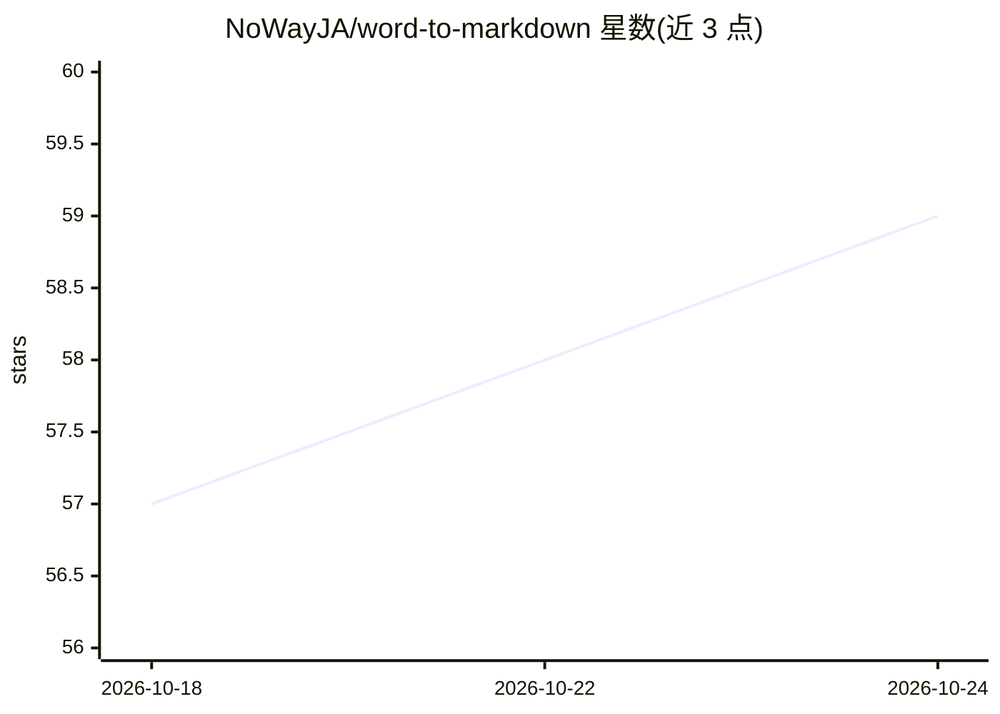

# NoWayJA/word-to-markdown

⭐ 59 · TypeScript · MIT · 推送 2026-02-04 · [GitHub](https://github.com/NoWayJA/word-to-markdown) · 个人维护

**浏览器本地运行的 Word/PDF 转 Markdown 隐私工具**

纯前端 Web 应用，在浏览器内将 .docx 与 PDF 转换为 Markdown，处理全程在本地完成、无需上传。可作为独立 HTML 文件双击离线运行，也提供在线版本（同样本地处理）。功能含拖放转换、三种图片处理模式（独立文件夹/Base64 内嵌/纯文本）、ZIP 打包下载与剪贴板复制，输出面向 Ollama、LM Studio、GPT4All 等本地 LLM 场景。限制：仅支持 .docx（不支持 .doc）、扫描版 PDF 效果有限、文件上限 200MB、修订与批注不保留。

## 筛选速览

| 维度 | 判定 | 备注 |
|---|---|---|
| AI 角色 | `ai-ecosystem` | LLM/agent 周边工具 |
| 许可风险 | `permissive` | MIT |
| 部署形态 | `desktop` | 安装包/桌面程序 |
| 模型依赖 | local-ok | 支持本地模型 |
| 硬件要求 | — | 无带数字的原话,不猜 |
| 安装摩擦 | `low` | 无编译、无系统依赖或容器化 |
| 成熟度 | — | 结构信号不足 |

## 能力要点

- 全部转换在浏览器本地完成，零数据上传，支持完全离线的单 HTML 文件
- 支持 .docx 与 PDF 输入，三种图片处理模式
- 输出面向 Ollama、LM Studio、GPT4All 等本地 LLM 使用场景
- MIT 许可，提供 ZIP 下载与在线版本两种使用方式

## 适用场景

- 把含敏感信息的商务、法律、医疗文档离线转成 Markdown 喂给本地 LLM
- 在无网络环境（如隔离网）转换文档
- 把 Word 报告转成 Markdown 后粘贴进 Ollama 对话界面

## 场景标签

`文档解析` · 领域:知识与检索

## 证据(README 行号)

> L5:  Convert Word & PDF documents to LLM-ready Markdown - 100% Private, No Data Upload
> L7:  A privacy-first web application that converts Word documents (.docx) and PDFs to clean Markdown format entirely in 
> L71: - **Optimized for Local LLMs** - Clean markdown output perfect for Ollama, LM Studio, GPT4All, and other local AI t

## 星数曲线

2026-10-18 57 → 2026-10-24 59（+2）

---
*卡片 v1 · prompt 1.4 · 生成 2026-10-24 · 置信度 high · 依据 README sha `c8bcbfa4abc4` · [字段定义](../../DATASET.md)*
