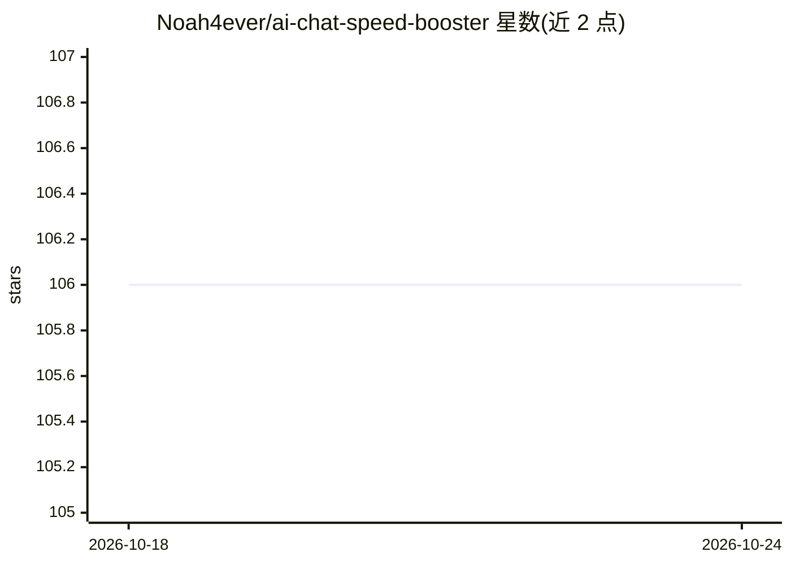

# Noah4ever/ai-chat-speed-booster

⭐ 106 · TypeScript · MIT · 推送 2026-05-20 · [GitHub](https://github.com/Noah4ever/ai-chat-speed-booster) · [官网](https://projects.thiering.org/ai-chat-speed-booster/) · 个人维护

**浏览器扩展：让长 AI 对话只加载最近消息以保持流畅**

面向 ChatGPT、Claude、Gemini 等 AI 聊天网站用户的浏览器扩展：默认只显示最近 3 条消息、隐藏较早消息，顶部提供 Load more 按钮分批加载；通过 fetch 拦截裁剪 API 数据以减少渲染负载，并 LRU 缓存最近 5 个会话加快切换。站点规则集中在 sites.config.json，可自行添加。支持 Chrome/Firefox/Edge/Safari 四端，经浏览器商店分发或源码构建；不读取、不上传消息内容，无分析追踪。

## 筛选速览

| 维度 | 判定 | 备注 |
|---|---|---|
| AI 角色 | `ai-enhanced` | 去掉 AI 部分产品仍成立 |
| 许可风险 | `permissive` | MIT |
| 部署形态 | `library` | 以包/库形式分发 |
| 模型依赖 | — | README 未给出锁定关系 |
| 硬件要求 | — | 无带数字的原话,不猜 |
| 安装摩擦 | `low` | 无编译、无系统依赖或容器化 |
| 成熟度 | — | 结构信号不足 |

## 能力要点

- 仅渲染最近消息（默认 3 条，可设 1-200），分批加载更早消息
- fetch 拦截方式裁剪 API 响应，减少渲染耗时
- LRU 缓存最近 5 个会话，加快会话切换
- 通过 sites.config.json 单文件添加新的 AI 聊天站点

## 适用场景

- 长 AI 对话变得卡顿时，用扩展只渲染最近消息保持响应速度
- 在 Chrome/Firefox/Edge/Safari 上使用同一扩展管理多个 AI 聊天站点
- 为自己常用的 AI 聊天网站添加自定义站点配置

## 场景标签

 · 领域:浏览器扩展/效率工具

## 证据(README 行号)

> L5: Keeps long AI chat conversations responsive by showing only recent messages first, then letting you load older ones 
> L148: - Shows the latest messages first (default: 3)

## 星数曲线

2026-10-18 106 → 2026-10-24 106（+0）

---
*卡片 v1 · prompt 1.4 · 生成 2026-10-23 · 置信度 high · 依据 README sha `2152f0739cd6` · [字段定义](../../DATASET.md)*
