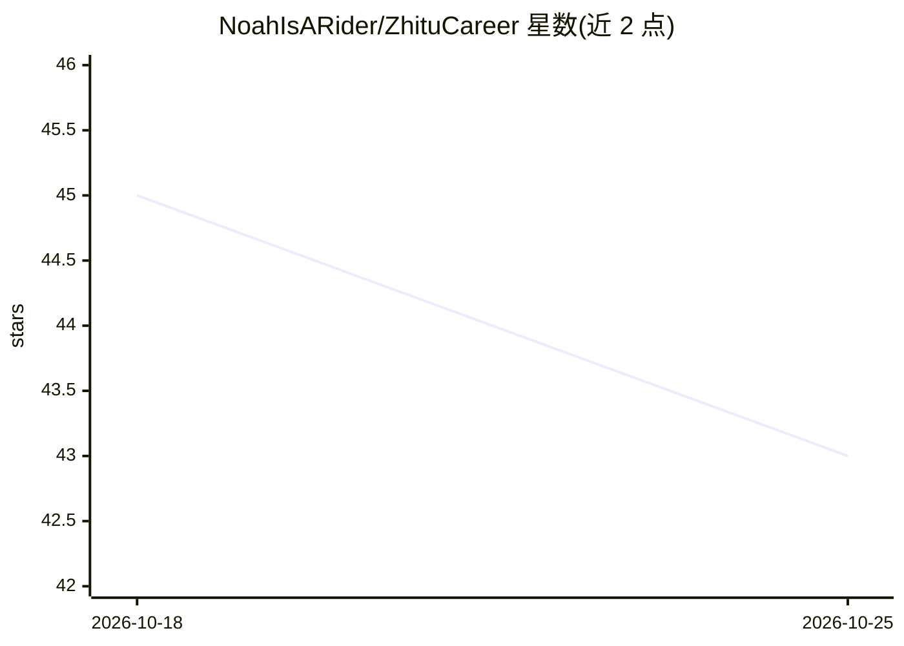

# NoahIsARider/ZhituCareer

⭐ 43 · Python · 推送 2026-08-12 · [GitHub](https://github.com/NoahIsARider/ZhituCareer) · 个人维护 · 中文 README

**面向求职者的 AI 职业分析与求职推荐 Web 平台**

基于 Flask 的 Web 应用，通过多个 LLM Agent 协作提供职业方向分析、职位匹配、课程推荐、AI 模拟面试（出题+逐题打分+总结）与五年三阶段职业规划；用 Playwright 抓取实时市场数据并由 LLM 总结趋势，检索层采用 TF-IDF+倒排索引混合检索先过滤再交给 LLM 重排。LLM 不可用时降级为规则引擎，全部功能离线可用。用户/管理员双角色，支持自注册、Docker 一键部署，内置演示账号与样例数据。

## 筛选速览

| 维度 | 判定 | 备注 |
|---|---|---|
| AI 角色 | `ai-native` | 本体是模型或模型工具 |
| 许可风险 | `none` | — |
| 部署形态 | `self-host` | docker 或自建部署 |
| 模型依赖 | — | README 未给出锁定关系 |
| 硬件要求 | — | 无带数字的原话,不猜 |
| 安装摩擦 | `low` | 无编译、无系统依赖或容器化 |
| 成熟度 | — | 结构信号不足 |

## 能力要点

- 多 Agent 协作流水线：画像/市场分析/推荐/匹配/面试/规划共 7 个 Agent
- LLM 不可用时规则引擎离线兜底，保持全部功能与响应格式
- TF-IDF+倒排索引混合检索，LLM 调用前将候选集压至 ≤20 条
- AI 模拟面试：出题、逐题打分反馈与整场总结

## 适用场景

- 我填个人资料后想得到职业方向与求职建议
- 我想匹配适合自己技能的职位并获取学习路径
- 我想模拟目标岗位面试并获得打分与反馈
- 我想生成五年分阶段的职业规划路线图

## 场景标签

`多智能体` `AI 助手` · 领域:Agent 开发

## 证据(README 行号)

> L5: A one-stop career analysis platform built on **Flask + multi-agent collaboration (LLM + Playwright real-time market 
> L54: ZhituCareer+ uses a modular **agent collaboration architecture** in which multiple agents each do their part and wo
> L61: - **Interview Agent**: generates targeted interview questions and evaluates candidate answers with scores and feedb

## 星数曲线

2026-10-18 45 → 2026-10-25 43（-2）

---
*卡片 v1 · prompt 1.4 · 生成 2026-10-25 · 置信度 high · 依据 README sha `c21918a55273` · [字段定义](../../DATASET.md)*
