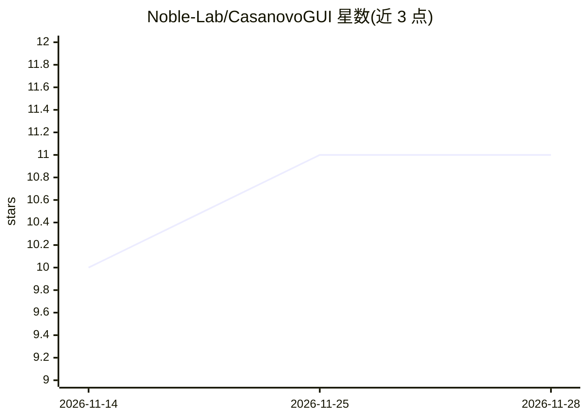

# Noble-Lab/CasanovoGUI

⭐ 11 · Java · GPL-3.0 · 推送 2026-10-20 · [GitHub](https://github.com/Noble-Lab/CasanovoGUI) · 组织维护

**为质谱从头测序工具 Casanovo 提供跨平台图形界面**

CasanovoGUI 是 Casanovo 的桌面图形界面，封装其命令行子命令——de novo 测序、数据库搜索、评估与训练——各占一个标签页，参数通过表单配置，输出在控制台实时显示。View 标签页可将肽段映射到参考蛋白组、查看分数分布与残基级置信度，并调用 PDV 做谱图注释可视化。安装包自带 Java 运行时，首次分析时若无 Casanovo 会自动下载私有 Python 环境与 Casanovo，无需手动安装工具。

## 筛选速览

| 维度 | 判定 | 备注 |
|---|---|---|
| AI 角色 | `ai-native` | 本体是模型或模型工具 |
| 许可风险 | `viral` | GPL-3.0 |
| 部署形态 | `desktop` | 安装包/桌面程序 |
| 模型依赖 | — | README 未给出锁定关系 |
| 硬件要求 | — | 无带数字的原话,不猜 |
| 安装摩擦 | `medium` | 含编译或系统依赖之一 |
| 成熟度 | — | 结构信号不足 |

## 能力要点

- 封装 Casanovo 四类子命令（测序/库搜索/评估/训练）为独立标签页
- 安装包捆绑 Java 运行时并可自动安装 Casanovo 及私有 Python
- View 标签页支持肽段-蛋白组映射与残基级置信度查看
- 集成 PDV 进行注释谱图可视化

## 适用场景

- 无需命令行即可运行蛋白质组 de novo 测序分析
- 在 Windows/macOS/Linux 桌面上统一管理 Casanovo 任务
- 查看测序结果的分数分布并用 PDV 检查谱图

## 场景标签

`科研工具` · 领域:学习与行业

## 证据(README 行号)

> L7: from MS/MS spectra with a transformer model. Configure your inputs and parameters
> L9: console. The GUI wraps Casanovo's command-line sub-commands — *de novo* sequencing,
> L30: analysis, if Casanovo isn't already on your machine the GUI offers to **install it

## 星数曲线

2026-11-14 10 → 2026-11-28 11（+1）

---
*卡片 v1 · prompt 1.4 · 生成 2026-11-20 · 置信度 high · 依据 README sha `1048916c1fa3` · [字段定义](../../DATASET.md)*
