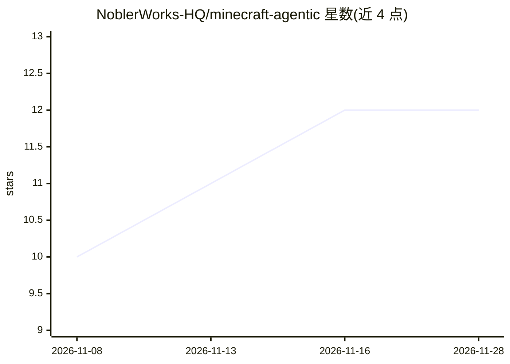

# NoblerWorks-HQ/minecraft-agentic

⭐ 12 · JavaScript · MIT · 推送 2026-11-25 · [GitHub](https://github.com/NoblerWorks-HQ/minecraft-agentic) · [官网](https://noblerworks.com/) · 组织维护

**多智能体 LLM 驱动 Minecraft 机器人协作建造，浏览器观看**

开源多智能体 Minecraft 建造器：LLM 将一句话描述转为建造计划，四个 Mineflayer 机器人按角色分工（石匠/木匠/装饰/景观）逐块放置方块，过程流式传输到浏览器 3D 视图，无需 Minecraft 账号。默认使用内置免费程序化生成库（无 API key），可配置 Gemini/Claude/OpenAI/Ollama 后端支持任意自定义提示。内置两轮自检：重读世界补放缺失方块，可选视觉模型从三个角度拍照打分并修复。要求 Docker 与 Node.js 22+，npm 安装运行。

## 筛选速览

| 维度 | 判定 | 备注 |
|---|---|---|
| AI 角色 | `ai-native` | 本体是模型或模型工具 |
| 许可风险 | `permissive` | MIT |
| 部署形态 | `library` | 以包/库形式分发 |
| 模型依赖 | local-ok | 支持本地模型 |
| 硬件要求 | — | 无带数字的原话,不猜 |
| 安装摩擦 | `medium` | 含编译或系统依赖之一 |
| 成熟度 | — | 结构信号不足 |

## 能力要点

- 一句话生成建造计划，四个角色化 Mineflayer 机器人分工施工
- 内置免费程序化建造库，无 API key 即可运行
- ops 原语层：walls/door/window 等操作展开为数百方块，并按 1.20.1 注册表校验方块名
- 两轮自检：游戏世界验证补块，可选视觉模型照片评审与修复

## 适用场景

- 在浏览器里看 AI 机器人逐步建造城堡
- 没有 Minecraft 账号也能观看建造过程
- 用自然语言描述建筑并放置在指定位置
- 本地离线运行（Ollama）生成建造

## 场景标签

`多智能体` · 领域:Agent 开发

## 证据(README 行号)

> L19: *An open-source multi-agent AI Minecraft builder: an LLM (Claude, Gemini, GPT, Ollama - or a
> L41: Type one line - *"a haunted mansion with a graveyard"* - and an AI turns it into a build
> L126: |**Ollama**|none|Free|Fully local/offline. Needs a real GPU. `LLM_PROVIDER=ollama`.|

## 星数曲线

2026-11-08 10 → 2026-11-28 12（+2）

---
*卡片 v1 · prompt 1.4 · 生成 2026-11-18 · 置信度 high · 依据 README sha `5368852b5263` · [字段定义](../../DATASET.md)*
