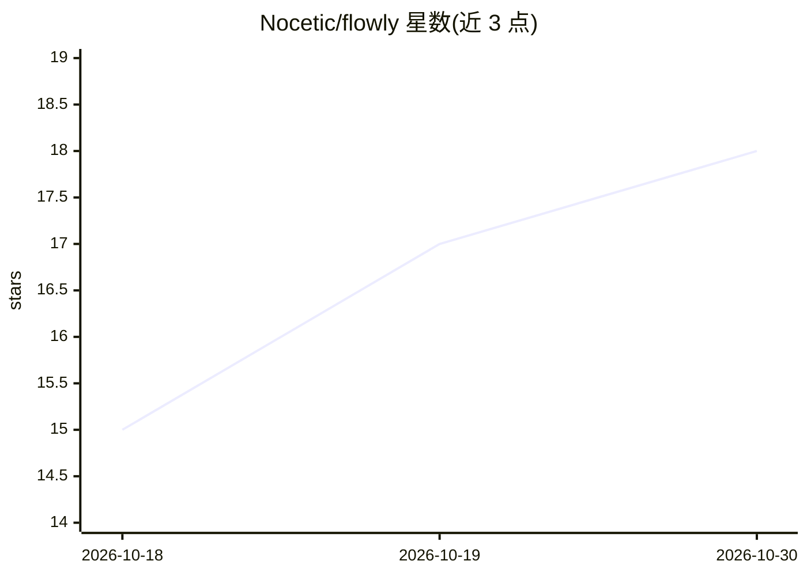

# Nocetic/flowly

⭐ 18 · Python · Apache-2.0 · 推送 2026-10-27 · [GitHub](https://github.com/Nocetic/flowly) · [官网](https://www.useflowlyapp.com) · 组织维护

**可自托管的开源个人 AI agent：自带记忆、技能与多渠道接入**

运行在用户自己机器上的个人 AI agent，使用用户自有 LLM key（OpenRouter、Anthropic、OpenAI、Gemini、Groq、xAI、智谱或 Ollama/LM Studio/vLLM 本地模型）。核心机制：跨对话共享的可治理记忆（信任评分、后台合并去重）与知识图谱，40+ 内置工具、135 个技能，支持子 agent 委派、定时任务、MCP 双向连接、Python 插件。可通过终端 TUI 或 Telegram/Discord/Slack/WhatsApp 等消息渠道使用，进程运行于 OS 沙箱内。Agent 核心为 Apache 2.0，无需账号；原生移动端应用与跨设备同步等属可选的 Flowly Cloud 服务。

## 筛选速览

| 维度 | 判定 | 备注 |
|---|---|---|
| AI 角色 | `ai-native` | 本体是模型或模型工具 |
| 许可风险 | `permissive` | Apache-2.0 |
| 部署形态 | `library` | 以包/库形式分发 |
| 模型依赖 | local-ok | 支持本地模型 |
| 硬件要求 | — | 无带数字的原话,不猜 |
| 安装摩擦 | `low` | 无编译、无系统依赖或容器化 |
| 成熟度 | — | 结构信号不足 |

## 能力要点

- BYOK 多 provider 适配（含 Ollama/LM Studio/vLLM 本地模型）与级联回退
- 可治理记忆：信任评分、👍/👎 修正、后台合并与知识图谱
- 40+ 工具、135 内置技能、MCP 双向、Python 插件扩展
- 多渠道接入（Telegram/Discord/Slack/Teams/WhatsApp/iMessage/邮件）与 OS 沙箱隔离

## 适用场景

- 在自有机器/VPS 上跑一个长期记住我个人信息的 AI 助手
- 通过 Telegram 等日常聊天工具随时调用同一 agent
- 用自然语言定时任务让 agent 自主完成并推送结果到指定渠道

## 场景标签

`AI 助手` · 领域:对话与助手

## 证据(README 行号)

> L9: **Flowly is the personal AI agent you own** — it runs on _your_ machine, on _your_ LLM keys, and gets better the lon
> L63: ## Providers — bring your own key
> L65: Adapters for **OpenRouter, Anthropic, OpenAI, Google Gemini, Groq, xAI / Grok, Zhipu / GLM**, any **OpenAI-compatib

## 星数曲线

2026-10-18 15 → 2026-10-30 18（+3）

---
*卡片 v1 · prompt 1.4 · 生成 2026-10-30 · 置信度 mid · 依据 README sha `cd944c58a162` · [字段定义](../../DATASET.md)*
