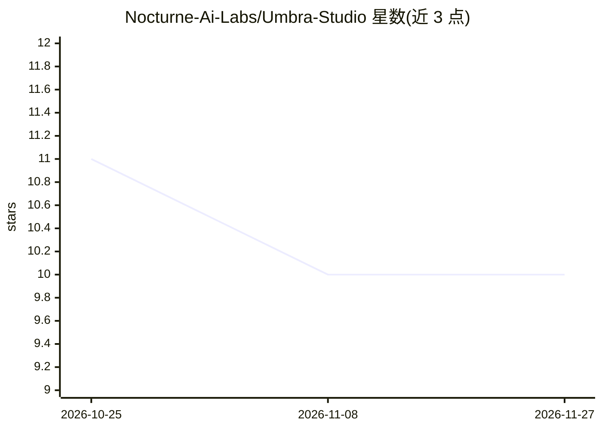

# Nocturne-Ai-Labs/Umbra-Studio

⭐ 10 · TypeScript · MIT · 推送 2026-11-21 · [GitHub](https://github.com/Nocturne-Ai-Labs/Umbra-Studio) · 组织维护

**便携式 AI 图像/视频创作工作台，统一管理 ComfyUI 生成工具链**

桌面优先的 AI 艺术创作应用，将生成后端、提示词工具、媒体浏览、元数据处理、模型管理与便携工具编排整合在一个应用内。功能覆盖文生图/图生图/局部重绘、实验性 Canvas 图层编辑、Power Prompter 提示词卡、Manga Studio 漫画编排导出、Booru 数据集策展与打标、背景移除/水印/放大等媒体工具，以及基于 DaSiWa 官方工作流的视频生成；通过 Setup 安装并维护 ComfyUI、AI Toolkit 等受管工具。Windows/Linux 提供便携包，生成与训练目前要求 NVIDIA GPU。

## 筛选速览

| 维度 | 判定 | 备注 |
|---|---|---|
| AI 角色 | `ai-native` | 本体是模型或模型工具 |
| 许可风险 | `permissive` | MIT |
| 部署形态 | `desktop` | 安装包/桌面程序 |
| 模型依赖 | — | README 未给出锁定关系 |
| 硬件要求 | — | 无带数字的原话,不猜 |
| 安装摩擦 | `high` | 编译与系统依赖俱全 |
| 成熟度 | `idea` | |

## 能力要点

- 便携发行版自带 Bun 运行时并自动搭建隔离 Python 环境，无需全局安装 Bun/Python
- 图像生成支持 TXT2IMG/IMG2IMG/inpainting 与 LoRA 堆栈、hires fix、放大等管线
- Manga Studio 支持模板排页、图层与对白，导出 PNG/PDF 与自包含 HTML 阅读器
- Umbra Setup 统一管理 ComfyUI、AI Toolkit、自定义节点与模型下载及更新

## 适用场景

- 在一个桌面应用内完成图像生成、提示词管理与输出整理
- 搭建并导出训练用图像-描述对数据集
- 用兼容管线生成漫画页面并导出电子版
- 通过手机端 Umbra Remote 远程操作主机上的图像/视频生成

## 场景标签

`图像生成` `视频生成` `提示工程` `微调` · 领域:Agent 开发

## 证据(README 行号)

> L11: Umbra Studio is a desktop-first AI art and workflow application built to unify
> L26: |**Image generation**|TXT2IMG, IMG2IMG, inpainting and model-aware pipelines with LoRA stacks, trigger information,
> L33: |**Video**|DaSiWa MiniMax H3 and LTX workflows, plus optional upstream Longshot Studio and Frame Forge interfaces. 

## 星数曲线

2026-10-25 11 → 2026-11-27 10（-1）

---
*卡片 v1 · prompt 1.4 · 生成 2026-11-20 · 置信度 high · 依据 README sha `291e80ccd814` · [字段定义](../../DATASET.md)*
