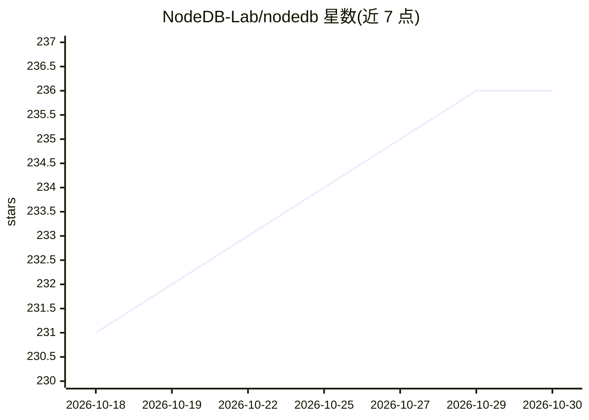

# NodeDB-Lab/nodedb

⭐ 236 · Rust · NOASSERTION · 推送 2026-10-25 · [GitHub](https://github.com/NodeDB-Lab/nodedb) · [官网](https://nodedb.dev) · 组织维护

**面向 AI agent 的多模型内存与存储引擎，边到云、兼容 PostgreSQL**

NodeDB 是定位为 AI agent 记忆与存储引擎的多模数据库：向量、图、文档、列存、时序、空间、KV、全文、NDArray 九类能力共享一个存储核心与查询计划器，通过 pgwire 兼容 PostgreSQL 客户端，另支持 HTTP/WebSocket/RESP/ILP/MessagePack 六种协议。部署形态含嵌入式 NodeDB-Lite（含 WASM，实验性）与分布式服务器 NodeDB Origin（Multi-Raft、CRDT 同步）。面向构建 agent 与本地优先应用的开发者。当前为 public beta（v0.6.2），存储格式在小版本间可能不兼容；采用 source-available 混合许可。

## 筛选速览

| 维度 | 判定 | 备注 |
|---|---|---|
| AI 角色 | `ai-ecosystem` | LLM/agent 周边工具 |
| 许可风险 | `none` | NOASSERTION |
| 部署形态 | `self-host` | docker 或自建部署 |
| 模型依赖 | — | README 未给出锁定关系 |
| 硬件要求 | — | 无带数字的原话,不猜 |
| 安装摩擦 | `low` | 无编译、无系统依赖或容器化 |
| 成熟度 | `idea` | |

## 能力要点

- 九类引擎（向量/图/文档/列存/时序/空间/KV/全文/NDArray）单一进程、跨引擎融合查询
- 嵌入式 NodeDB-Lite（多平台+WASM）与 Origin 服务器经 CRDT 同步，同一 API
- PostgreSQL 线协议，可用 psql 及任意 PG 客户端连接
- RBAC、行级安全、双时态查询、CDC 变更流等数据库功能

## 适用场景

- 为 AI agent 提供可查询、带访问控制的持久记忆层
- 本地优先应用离线运行并多设备 CRDT 同步
- 用单一引擎替代向量库+图库+文档库的多系统组合
- 做 RAG / GraphRAG / agent memory 的后端存储

## 场景标签

`Agent 记忆` `向量数据库` · 领域:Agent 开发

## 证据(README 行号)

> L5:  Durable, queryable, access-guarded memory for AI agents that runs where the agent runs —
> L37: AI agents need memory: what they were told, how facts relate, what happened when, and what matters right now. The u
> L122: |**Origin (server)**|Full distributed database. Multi-Raft, io_uring, pgwire. Horizontal scaling.|

## 星数曲线

2026-10-18 231 → 2026-10-30 236（+5）

---
*卡片 v1 · prompt 1.4 · 生成 2026-10-22 · 置信度 high · 依据 README sha `779de2f7241f` · [字段定义](../../DATASET.md)*
