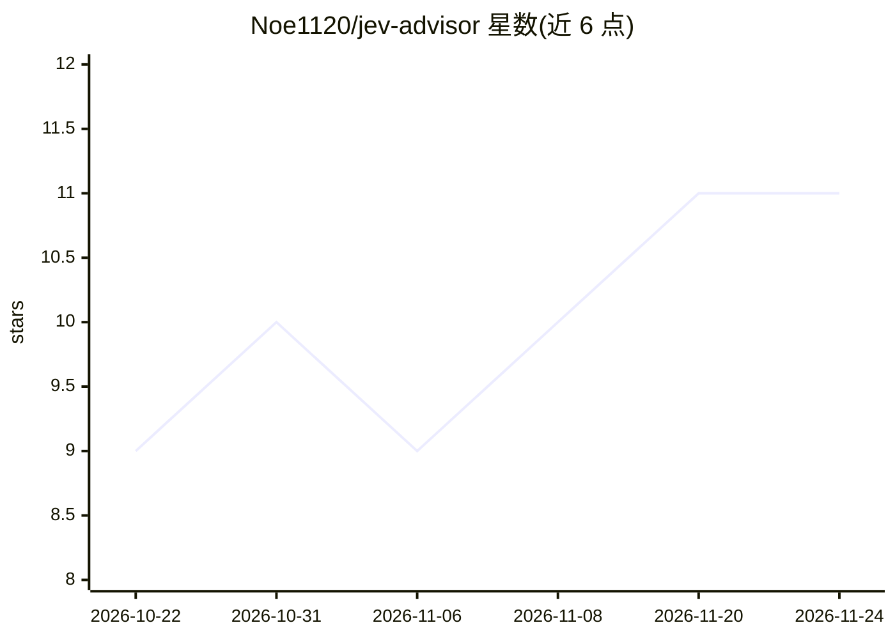

# Noe1120/jev-advisor

⭐ 11 · Python · MIT · 推送 2026-09-24 · [GitHub](https://github.com/Noe1120/jev-advisor) · 个人维护

**为 Codex agent 提供本地工具决策建议的 Skill**

以 Codex Skill 形式运行的本地决策建议组件：在工具调用生命周期的 understand/explore/implement/verify/recover/finish 等阶段，将可见上下文投影为紧凑 JSON 请求，对候选动作按成功率、时延、信息增益、token 成本、可逆性与风险等指标排序，并输出是否继续、切换工具、询问用户或结束的建议。建议仅返回给宿主模型，advisor 本身无执行权限。默认后端为确定性启发式，仅依赖 Python 标准库；可选本地模型后端需另行部署。尚未发布对照基准数据。

## 筛选速览

| 维度 | 判定 | 备注 |
|---|---|---|
| AI 角色 | `ai-ecosystem` | LLM/agent 周边工具 |
| 许可风险 | `permissive` | MIT |
| 部署形态 | `library` | 以包/库形式分发 |
| 模型依赖 | — | README 未给出锁定关系 |
| 硬件要求 | — | 无带数字的原话,不猜 |
| 安装摩擦 | `medium` | 含编译或系统依赖之一 |
| 成熟度 | — | 结构信号不足 |

## 能力要点

- 覆盖工具调用全生命周期的 7 阶段决策协议
- 10 类命名风险逐候选评估（破坏性、凭证、网络暴露等）
- 默认确定性启发式后端仅依赖 Python 标准库，本地运行且 fails-open
- 基于状态与 Git 指纹的等价决策本地缓存

## 适用场景

- 在 Codex 中减少冗余或不必要的工具调用
- 工具调用失败后按建议选择重试、换工具或询问用户
- 要求任务完成前提供可观测验证证据的 agent 工作流

## 场景标签

`Agent 框架` · 领域:Agent 开发

## 证据(README 行号)

> L9: Jev Advisor is a private, local decision-advice Skill for Codex. At meaningful decision points, it compares the avai
> L24: Without a decision advisor, the host model must repeatedly evaluate every tool option, cost, risk, and stopping con
> L46: The Skill decides when a decision is substantial enough to consult the runtime. It projects the current visible con

## 星数曲线

2026-10-22 9 → 2026-11-24 11（+2）

---
*卡片 v1 · prompt 1.4 · 生成 2026-11-20 · 置信度 high · 依据 README sha `940141b98239` · [字段定义](../../DATASET.md)*
