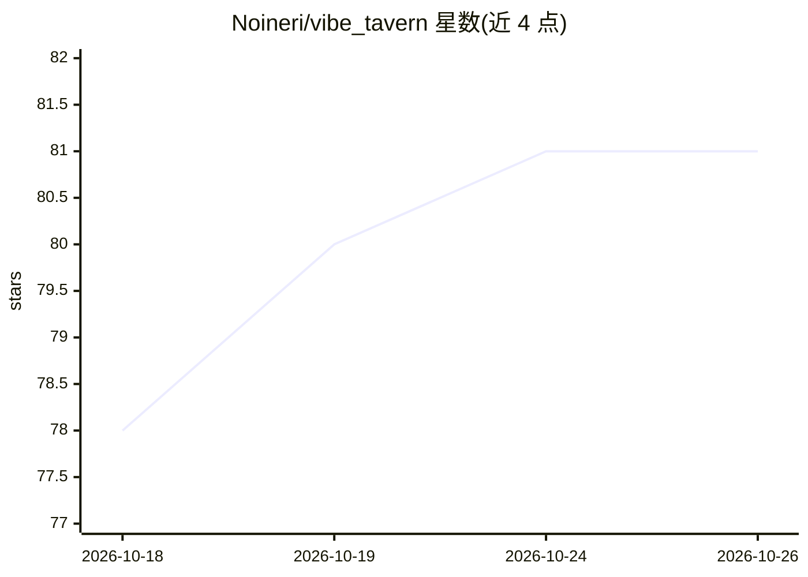

# Noineri/vibe_tavern

⭐ 81 · TypeScript · AGPL-3.0 · 推送 2026-10-23 · [GitHub](https://github.com/Noineri/vibe_tavern) · [官网](https://vibe-tavern.com) · 个人维护 · 中文 README

**本地优先的 AI 角色扮演聊天客户端，支持桌面与手机**

单人开发者构建的本地 AI roleplay 客户端：围绕长会话与移动端使用设计，用户自带 API key、数据留在本机。功能包括角色创作（Co-Author 协作编辑）、可视化提示词组装与 Prompt Trace、世界书（Lorebooks）高级激活逻辑、摘要记忆、骰子/目标/场景追踪、JS 脚本与沙盒、14 种 TTS 引擎与多种 STT 后端的完整语音栈。兼容 SillyTavern 卡片/预设/正则格式导入。提供 Windows 安装包、Linux 版、Docker 与 Android 启动器，也可经 Bun 全局安装。项目处于活跃开发期，README 提示更新前备份数据目录。

## 筛选速览

| 维度 | 判定 | 备注 |
|---|---|---|
| AI 角色 | `ai-native` | 本体是模型或模型工具 |
| 许可风险 | `viral` | AGPL-3.0 |
| 部署形态 | `desktop` | 安装包/桌面程序 |
| 模型依赖 | — | README 未给出锁定关系 |
| 硬件要求 | — | 无带数字的原话,不猜 |
| 安装摩擦 | `low` | 无编译、无系统依赖或容器化 |
| 成熟度 | `idea` | |

## 能力要点

- 提示词可视化组装与 Prompt Trace（展示实际请求各层与 token 占用）
- 世界书支持 AND/OR/NOT、概率、冷却、递归扫描与包含组
- 语音栈覆盖 14 种 TTS 引擎与 whisper.cpp 等多种 STT 后端
- 兼容 SillyTavern V2/V3 卡片、预设与正则格式导入

## 适用场景

- 在本地进行长篇 AI 角色扮演并精细控制提示词与记忆
- 在手机上通过局域网 QR 访问自己的会话
- 导入既有的 SillyTavern 角色卡与预设继续使用

## 场景标签

`聊天机器人` `语音合成` `语音识别` · 领域:对话与助手

## 证据(README 行号)

> L5: **A local AI roleplay client built for good UX, long sessions, and mobile screens that don't feel like an afterthoug
> L61: Vibe Tavern is a local AI roleplay client I am building around everyday comfort, long-running sessions, and mobile 
> L67: You bring your own API keys, your data stays on your machine, and nearly everything important can be inspected, cha

## 星数曲线

2026-10-18 78 → 2026-10-26 81（+3）

---
*卡片 v1 · prompt 1.4 · 生成 2026-10-24 · 置信度 high · 依据 README sha `12d88b1d8865` · [字段定义](../../DATASET.md)*
