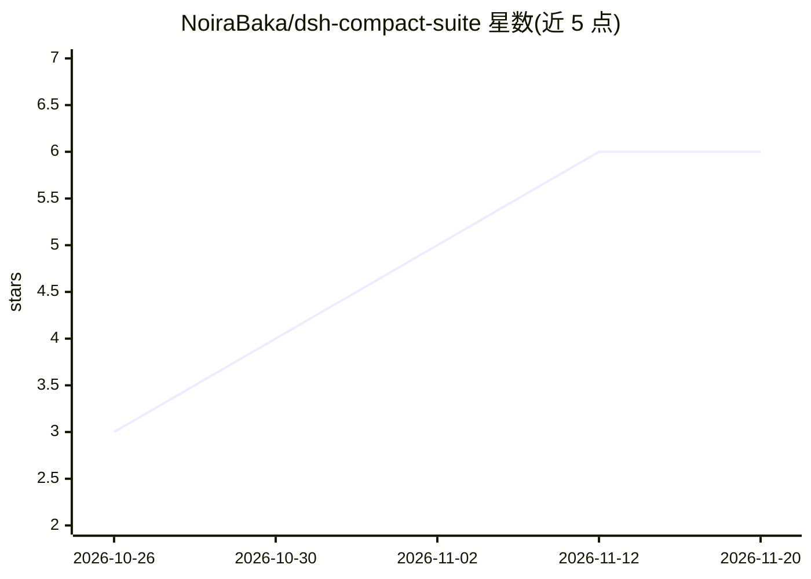

# NoiraBaka/dsh-compact-suite

⭐ 6 · JavaScript · NOASSERTION · 推送 2026-10-27 · [GitHub](https://github.com/NoiraBaka/dsh-compact-suite) · 个人维护 · 中文 README

**给 DSH 加上下文压缩控制面板的插件：管理压缩时机与摘要模型**

以 DSH 插件（.tgz 安装包）形式提供的压缩控制面板：支持手动触发压缩、滑块调节触发阈值、指定摘要用模型、设置压缩后保留量，并提供每会话压缩记录（压前/压后 token 数）。总开关关闭或卸载后 DSH 恢复原状。通过 DSH 设置→插件→安装加载，开发者可 git clone 源码后 npm pack 自行打包。兼容性上 2.9.2 版要求 DSH 0.2.1-rc.1 及以上，旧版 DSH 需用 2.8.9。

## 筛选速览

| 维度 | 判定 | 备注 |
|---|---|---|
| AI 角色 | `ai-ecosystem` | LLM/agent 周边工具 |
| 许可风险 | `none` | NOASSERTION |
| 部署形态 | `None` |  |
| 模型依赖 | — | README 未给出锁定关系 |
| 硬件要求 | — | 无带数字的原话,不猜 |
| 安装摩擦 | `low` | 无编译、无系统依赖或容器化 |
| 成熟度 | — | 结构信号不足 |

## 能力要点

- 手动触发压缩并自动守保留量，压完阈值还原
- 摘要压缩可指定独立模型，主模型不重读历史
- 滑块调节触发阈值、设置压缩后保留对话量
- 总开关关闭即完整还原 DSH 原行为

## 适用场景

- 接管 DSH 自动压缩的时机与参数
- 压缩摘要换用指定模型以减轻主模型负担
- 查看本会话每次压缩省了多少上下文

## 场景标签

`Agent 记忆` · 领域:Agent 开发

## 证据(README 行号)

> L3: 给 DSH 的上下文压缩加一个控制面板。
> L13: - **用哪个模型压，你说了算** —— 摘要交给指定的模型，主模型不用从头读一遍历史。

## 星数曲线

2026-10-26 3 → 2026-11-20 6（+3）

---
*卡片 v1 · prompt 1.4 · 生成 2026-11-20 · 置信度 mid · 依据 README sha `55698b292df8` · [字段定义](../../DATASET.md)*
