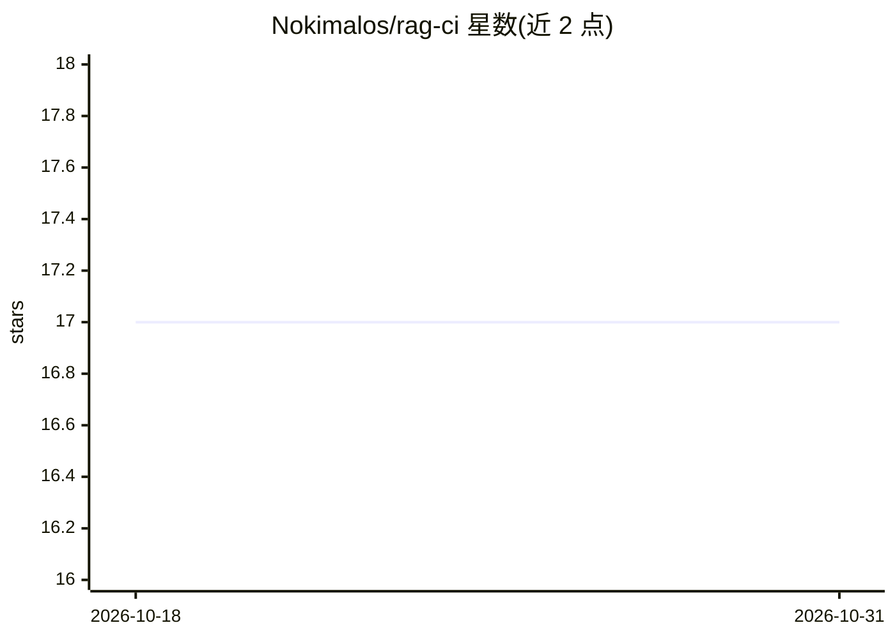

# Nokimalos/rag-ci

⭐ 17 · Python · MIT · 推送 2026-08-13 · [GitHub](https://github.com/Nokimalos/rag-ci) · 个人维护

**RAG 检索管线的回归测试与配置扫描 CLI，用显著性检验门控变更**

面向 RAG 开发者的评测与 CI 工具：对同一问题集运行两版管线，用配对 bootstrap（10,000 次重采样、95% CI）比较检索指标，仅当差异既显著又超过 min-effect 时才阻断构建（退出码 1），无法可信比较时退出码 2。golden 集的真值锚定到文档段落而非 chunk，故可跨 chunk 配置复用；支持配置扫描（successive halving）与适配任意框架（写一个 adapter 文件，无 RAG 框架依赖）。除可选的问题生成（需 ANTHROPIC_API_KEY）外无模型依赖。提供 GitHub Action 与任意 CI 的 CLI 用法。

## 筛选速览

| 维度 | 判定 | 备注 |
|---|---|---|
| AI 角色 | `ai-ecosystem` | LLM/agent 周边工具 |
| 许可风险 | `permissive` | MIT |
| 部署形态 | `None` |  |
| 模型依赖 | — | README 未给出锁定关系 |
| 硬件要求 | — | 无带数字的原话,不猜 |
| 安装摩擦 | `low` | 无编译、无系统依赖或容器化 |
| 成熟度 | — | 结构信号不足 |

## 能力要点

- 双条件门控：统计显著且超过 min-effect 才阻断，避免噪声误报
- 真值锚定文档段落而非 chunk，chunk 配置变更后 golden 集仍可用
- 适配器契约无 RAG 框架依赖，支持多步检索与 agentic 管线
- 大语料支持：流式采样、successive halving 扫描与结果外推

## 适用场景

- 在 CI 中对 RAG 管线改动做回归检测，阻断检索质量下降的 PR
- 扫描 chunk 大小等配置并判断最优配置是否真的更好
- 验证 reranker 等检索增强是否仍有实际贡献

## 场景标签

`模型评测` · 领域:评测与运维

## 证据(README 行号)

> L9: rag-ci measures every change to your RAG pipeline against a baseline and fails the pull
> L56: To be precise about the gap: promptfoo
> L59: verdict on a significance test. They compare a score to a threshold; rag-ci compares two runs

## 星数曲线

2026-10-18 17 → 2026-10-31 17（+0）

---
*卡片 v1 · prompt 1.4 · 生成 2026-10-30 · 置信度 high · 依据 README sha `2b7a9efed961` · [字段定义](../../DATASET.md)*
