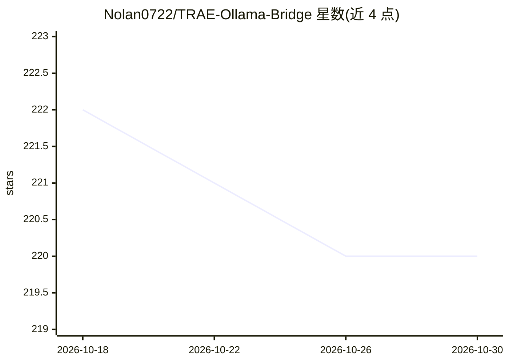

# Nolan0722/TRAE-Ollama-Bridge

⭐ 220 · JavaScript · MIT · 推送 2026-06-03 · [GitHub](https://github.com/Nolan0722/TRAE-Ollama-Bridge) · 个人维护 · 中文 README

**将本地 Ollama 包装为 OpenAI 兼容接口的桥接代理**

面向 TRAE 等无法自定义模型服务商或 Base URL 的 IDE 用户的代理服务：把本地 Ollama 模型包装为 OpenAI 兼容的 /v1 接口，支持流式/非流式响应与模型映射管理。提供 WebUI 管理映射与聊天测试；通过本地 CA 证书、hosts 写入与 443 端口转发的系统拦截策略，透明接管固定访问 api.openai.com 的客户端。需预先配置好可运行的 Ollama 环境，README 声明因 TRAE 已原生支持 Ollama 而停止维护。

## 筛选速览

| 维度 | 判定 | 备注 |
|---|---|---|
| AI 角色 | `ai-ecosystem` | LLM/agent 周边工具 |
| 许可风险 | `permissive` | MIT |
| 部署形态 | `None` |  |
| 模型依赖 | local-ok | 支持本地模型 |
| 硬件要求 | — | 无带数字的原话,不猜 |
| 安装摩擦 | `low` | 无编译、无系统依赖或容器化 |
| 成熟度 | — | 结构信号不足 |

## 能力要点

- OpenAI 兼容 /v1 接口，支持流式/非流式响应
- 本地 Ollama 模型映射为 OpenAI 风格模型 ID
- 透明拦截模式：本地 CA + hosts + 443 端口转发接管固定请求
- WebUI 管理映射、模型列表与聊天测试，支持可选 API Key 校验

## 适用场景

- 在不能改 Base URL 的 IDE 中调用本地 Ollama 模型
- 透明接管固定访问 api.openai.com 的客户端
- 通过 WebUI 管理模型映射并测试连通性

## 场景标签

`模型网关` · 领域:Agent 开发

## 证据(README 行号)

> L9:  由于在 TRAE （或其他IDE）中模型服务商被固定，无法使用本地Ollama模型或修改 Base URL。通过本项目，可让这些客户端直接与本地 Ollama 交互，绕开 IDE 限制。
> L12: 将本地 Ollama 模型包装为 OpenAI 兼容接口，用于解决在 TRAE 等 IDE 中无法自定义模型或 API Base 时的限制。
> L16: - OpenAI 兼容 `/v1` 接口：即插即用，兼容 TRAE 等主流 IDE 请求格式。

## 星数曲线

2026-10-18 222 → 2026-10-30 220（-2）

---
*卡片 v1 · prompt 1.4 · 生成 2026-10-22 · 置信度 high · 依据 README sha `9754bc74e764` · [字段定义](../../DATASET.md)*
