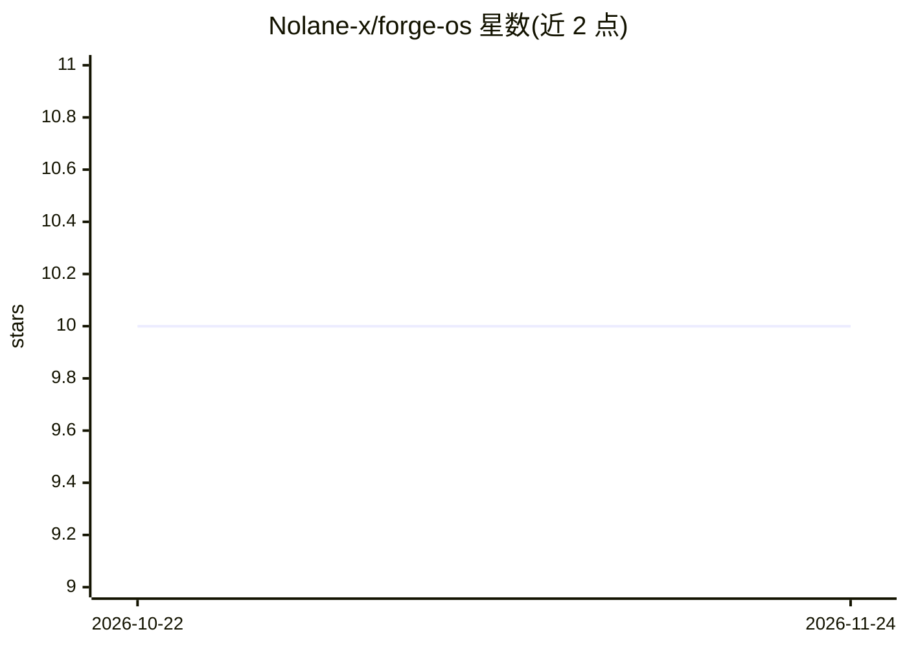

# Nolane-x/forge-os

⭐ 10 · JavaScript · MIT · 推送 2026-08-01 · [GitHub](https://github.com/Nolane-x/forge-os) · 个人维护

**AI agent 的运行时控制平面：技能路由、上下文治理与证据验证**

面向 AI agent 的控制平面运行时：通过技能智能路由器做两级检索与不安全近似拒绝，用全局上下文内核做整请求 token 预算，将技能编译为含确定性节点、审批与停止条件的执行图；配套覆盖台账（租约/围栏/恢复）、信任内核证据门、agent 表面安全扫描与本地代理执行。MIT 许可，Node/JavaScript 实现，npm 安装，含 60 个 MCP 工具与本地仪表盘。v0.6 官方声明无认证生产级技能，高风险执行需外部微VM 提供方。

## 筛选速览

| 维度 | 判定 | 备注 |
|---|---|---|
| AI 角色 | `ai-ecosystem` | LLM/agent 周边工具 |
| 许可风险 | `permissive` | MIT |
| 部署形态 | `library` | 以包/库形式分发 |
| 模型依赖 | — | README 未给出锁定关系 |
| 硬件要求 | — | 无带数字的原话,不猜 |
| 安装摩擦 | `low` | 无编译、无系统依赖或容器化 |
| 成熟度 | `idea` | |

## 能力要点

- 128 个深度内核技术契约与两级检索路由（Router Precision@1 93.75%）
- 全局上下文内核按段加载技能、惰性工具 schema 与逐工作单元隔离上下文
- 覆盖台账支持租约、心跳、围栏令牌与失败后恢复
- Agent 表面安全扫描（提示注入、密钥外泄路径等）与 20/20 对抗用例

## 适用场景

- 为 Codex、Claude Code 等宿主嵌入技能路由与上下文预算
- 需要可审计证据与发布门的 agent 工作流治理
- 对 agent 系统本身做安全扫描与权限差异检查
- 多 agent 编排中的工作单元租约与断点恢复

## 场景标签

`Agent 框架` `多智能体` · 领域:Agent 开发

## 证据(README 行号)

> L11:  Skill Intelligence OS and Trust Control Plane for AI agents.
> L44: It is not a prompt collection. It is the control plane around skills, rules, hooks, agents, tools, context, evidenc
> L156: Use this path when embedding ForgeOS into Codex, Claude Code, ChatGPT, an open-source agent, CI, or an internal pl

## 星数曲线

2026-10-22 10 → 2026-11-24 10（+0）

---
*卡片 v1 · prompt 1.4 · 生成 2026-11-20 · 置信度 high · 依据 README sha `60fc1179f99e` · [字段定义](../../DATASET.md)*
