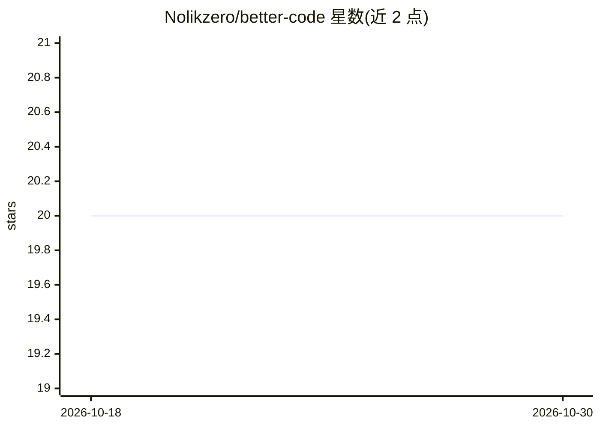

# Nolikzero/better-code

⭐ 20 · TypeScript · Apache-2.0 · 推送 2026-04-15 · [GitHub](https://github.com/Nolikzero/better-code) · 个人维护

**本地优先的 AI 编程助手桌面端，多后端并行会话**

基于 Electron 的跨平台桌面应用，为 Claude、OpenAI Codex、OpenCode 三种 AI 后端提供统一会话界面，可按会话切换后端与 Plan/Agent 模式。面向使用 AI 辅助编程的开发者：每个会话运行在独立 Git worktree 中，支持实时查看工具执行、可视化 diff 与 PR 管理、集成 xterm 终端、会话跨重启恢复。数据本地存储（SQLite + Drizzle ORM），无遥测。提供 macOS/Linux/Windows 安装包，也可用 Bun 从源码构建；Windows 构建标注为 experimental。

## 筛选速览

| 维度 | 判定 | 备注 |
|---|---|---|
| AI 角色 | `ai-ecosystem` | LLM/agent 周边工具 |
| 许可风险 | `permissive` | Apache-2.0 |
| 部署形态 | `desktop` | 安装包/桌面程序 |
| 模型依赖 | locked-api |  |
| 硬件要求 | — | 无带数字的原话,不猜 |
| 安装摩擦 | `medium` | 含编译或系统依赖之一 |
| 成熟度 | `idea` | |

## 能力要点

- Claude / Codex / OpenCode 三后端统一接口，可按会话切换
- Plan（只读分析）与 Agent（完整执行权限）双模式
- 每个会话隔离在独立 Git worktree 中
- 本地优先：无遥测、SQLite 本地存储

## 适用场景

- 在一个桌面应用中并行管理多个 AI 编程会话
- 对比不同 AI 后端在相同项目上的表现
- 在隔离的 Git worktree 中安全尝试 AI 生成的代码改动
- 跨重启恢复带完整上下文的编程对话

## 场景标签

`编码 Agent` · 领域:编码与开发

## 证据(README 行号)

> L3: **UI for parallel work with AI agents** -- a local-first Electron desktop app for AI-powered code assistance with mu
> L111: BetterCode supports multiple AI backends through a unified provider interface:
> L115: |Claude|`@anthropic-ai/claude-agent-sdk`|Anthropic Claude with full tool use|

## 星数曲线

2026-10-18 20 → 2026-10-30 20（+0）

---
*卡片 v1 · prompt 1.4 · 生成 2026-10-28 · 置信度 high · 依据 README sha `1e22b935159e` · [字段定义](../../DATASET.md)*
