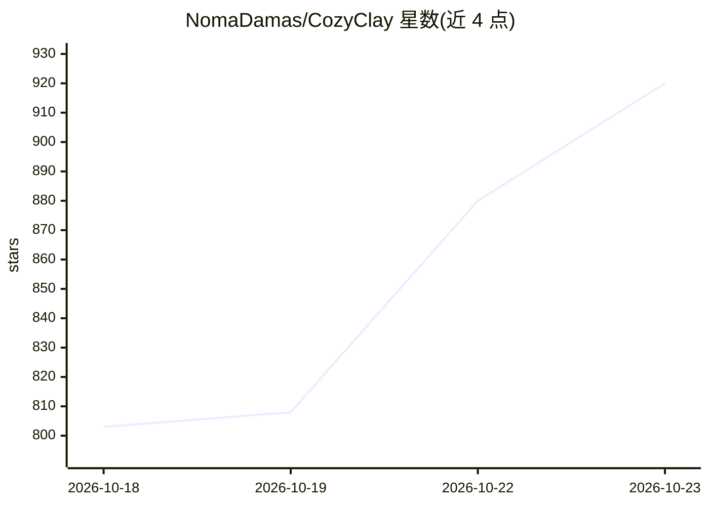

# NomaDamas/CozyClay

⭐ 920 · JavaScript · AGPL-3.0 · 推送 2026-10-22 · [GitHub](https://github.com/NomaDamas/CozyClay) · [官网](https://cozyclay.org) · 组织维护

**浏览器中的开源 3D 预演工具：排布场景与运镜后交给 AI 视频模型**

在浏览器标签页中运行的预可视化（previs）软件：用基础几何体搭建场景、放置绑定角色或胶囊替身、通过 Agent 生成动作规格并由确定性编译器烘焙每帧、做 QA 检查（碰撞/脚滑/接触），再在时间线上编排镜头与剪辑，导出首末帧、灰盒参考片段、mp4、深度/法线通道与提示词，供 AI 视频模型使用。面向需要在生成 AI 视频前先控制走位与运镜的创作者；可从 Agent 面板（ChatGPT 登录或自有 key）、MCP server 或终端 CLI 驱动。需 Node 22.19+ 与 Chromium，不需 GPU 或模型下载。

## 筛选速览

| 维度 | 判定 | 备注 |
|---|---|---|
| AI 角色 | `ai-enhanced` | 去掉 AI 部分产品仍成立 |
| 许可风险 | `viral` | AGPL-3.0 |
| 部署形态 | `library` | 以包/库形式分发 |
| 模型依赖 | — | README 未给出锁定关系 |
| 硬件要求 | — | 无带数字的原话,不猜 |
| 安装摩擦 | `low` | 无编译、无系统依赖或容器化 |
| 成熟度 | — | 结构信号不足 |

## 能力要点

- 确定性动作编译器在浏览器烘焙每帧并做碰撞/脚滑/接触 QA
- 导出关键帧包（首末帧、灰盒片段、相机、提示词）与 OTIO 剪辑表
- Agent 面板 / MCP server / 终端 CLI 三种 AI 驱动入口
- npx cozyclay 一条命令安装，无需 GPU、Python 或模型下载

## 适用场景

- 在花钱生成 AI 视频前先用 3D 灰盒确定走位、时机和运镜
- 让 Claude Desktop、Cursor 等 MCP 客户端直接驱动场景编辑
- 制作带分镜面板与动态分镜（animatic）的静帧故事板

## 场景标签

`视频生成` · 领域:内容生成

## 证据(README 行号)

> L4:  Open source previs in a browser tab: block the set, move the cast, cut the camera, hand the shot to an AI video mod
> L34:   S["Stage set + cast"] --> M["Motion compiled + QA"] --> C["Camera shots + cuts"] --> E["Export fr

## 星数曲线

2026-10-18 803 → 2026-10-23 920（+117）

---
*卡片 v1 · prompt 1.4 · 生成 2026-10-21 · 置信度 mid · 依据 README sha `adf1962d7655` · [字段定义](../../DATASET.md)*
