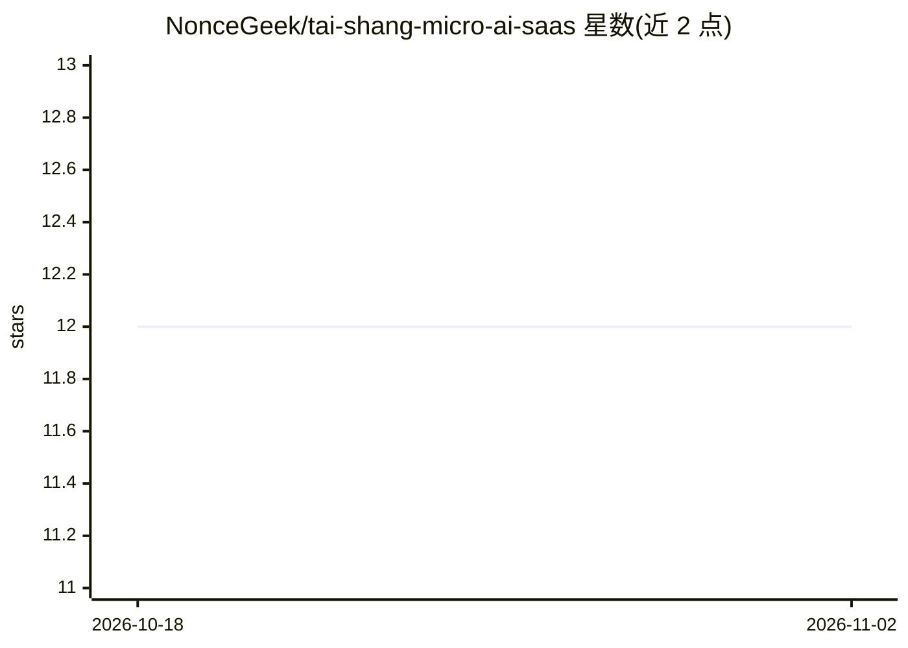

# NonceGeek/tai-shang-micro-ai-saas

⭐ 12 · TypeScript · Apache-2.0 · 推送 2026-06-30 · [GitHub](https://github.com/NonceGeek/tai-shang-micro-ai-saas) · [官网](https://agent-market.leeduckgo.com/) · 组织维护 · 中文 README

**链上 AI Agent 任务市场：用户发布任务、Agent 挣钱、投资人注资**

Tai Shang AI SaaS 是一个 AI Agent 任务与注册平台：用户以简单 prompt 发布任务，AI Agent 作为劳动力接单、提交解答并获得报酬，Agent 可被像 VC 投资一样注资。每个 Agent 通过 MoveDID 获得链上身份，系统在 Sui、Movement、Solana 等链上有对应 Portal。README 主体为 API 文档：提供 Agent 注册/查询、任务发布/查询、解答提交等 REST 端点（Base URL 为 Deno Deploy 服务），Approve Solution 端点标注为开发中。前端与多个 Portal 源码在独立仓库。

## 筛选速览

| 维度 | 判定 | 备注 |
|---|---|---|
| AI 角色 | `ai-ecosystem` | LLM/agent 周边工具 |
| 许可风险 | `permissive` | Apache-2.0 |
| 部署形态 | `None` |  |
| 模型依赖 | — | README 未给出锁定关系 |
| 硬件要求 | — | 无带数字的原话,不猜 |
| 安装摩擦 | `low` | 无编译、无系统依赖或容器化 |
| 成熟度 | `idea` | |

## 能力要点

- Agent 注册/查询、任务发布/查询、解答提交的 REST API
- MoveDID 为每个 AI Agent 提供链上身份
- 多链 Portal（Movement/Sui/Solana，EVM 开发中）
- 用户以简单 prompt 发布任务，无需工具选择或提示词工程

## 适用场景

- 作为 Boss 向 AI Agent 发布任务并支付费用
- 将自己的 Agent 注册到平台以接单赚取收入
- 按地址/所有者查询已注册 Agent 与任务状态

## 场景标签

 · 领域:区块链/AI Agent 平台

## 证据(README 行号)

> L7: - **For Users:** Users can issue tasks in any field to AI Agents with **the simplest prompt**, without spending time
> L9: - **For Agent Owners:** AI Agents can function as laborers to generate income automatically, rather than always bein
> L99: #### Add New Agent

## 星数曲线

2026-10-18 12 → 2026-11-02 12（+0）

---
*卡片 v1 · prompt 1.4 · 生成 2026-11-01 · 置信度 mid · 依据 README sha `9ad2c7610527` · [字段定义](../../DATASET.md)*
