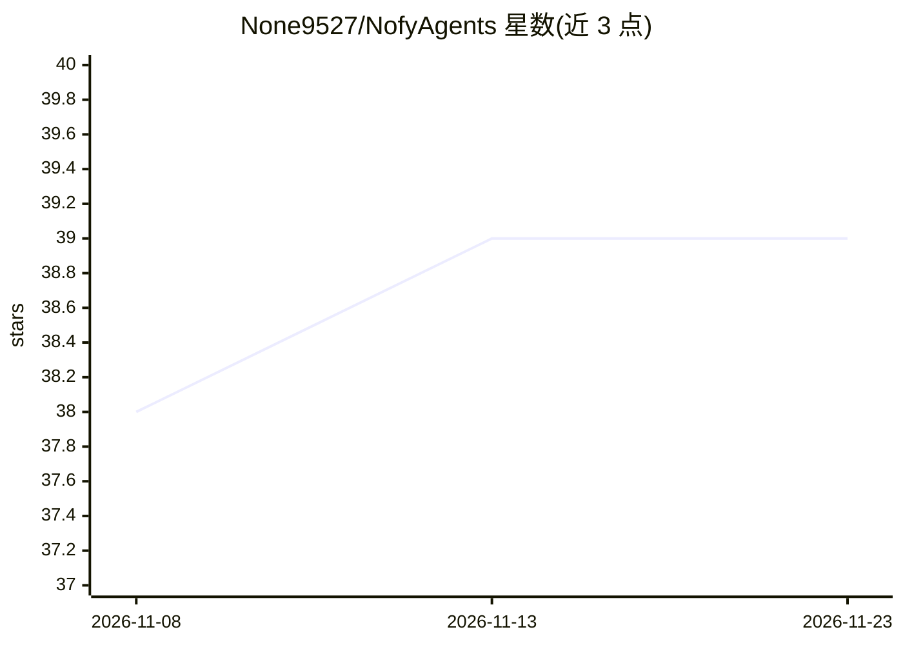

# None9527/NofyAgents

⭐ 39 · Rust · Apache-2.0 · 推送 2026-11-20 · [GitHub](https://github.com/None9527/NofyAgents) · 个人维护 · 中文 README

**用声明式方式组合并生成 agent 的 Rust 框架**

面向开发者的 agent 构建框架：以声明方式组合模型、工具、工作流、记忆、权限与会话，让编码 agent 通过 CLI 或 MCP 创建、构建、发布、运行其他 agent，并导出源码与依赖清单。所有 agent 共享同一 Rust 内核、Loader、执行路径与持久状态；内核授权、审批、预算与取消构成边界。当前为可用开发者预览版：CLI、入站 MCP 服务器、模块化会话已实现，无前端，完整自主改进闭环尚未端到端验收。从仓库用 cargo 构建运行，Linux 为主要评估平台，详细技术文档以中文为主。

## 筛选速览

| 维度 | 判定 | 备注 |
|---|---|---|
| AI 角色 | `ai-ecosystem` | LLM/agent 周边工具 |
| 许可风险 | `permissive` | Apache-2.0 |
| 部署形态 | `None` |  |
| 模型依赖 | — | README 未给出锁定关系 |
| 硬件要求 | — | 无带数字的原话,不猜 |
| 安装摩擦 | `low` | 无编译、无系统依赖或容器化 |
| 成熟度 | `idea` | |

## 能力要点

- CLI/HTTP/MCP 编辑同一事实源，98 个操作（含 96 个入站 MCP 工具）
- 十七种会话操作覆盖准入、后续轮次、归档与轮间策略变更
- 凭据仅经独立私有入口注入，不出现在命令行与日志
- 源码归档含声明、模块源码与依赖清单，可回滚到指定 release

## 适用场景

- 让编码 agent 通过 CLI/MCP 自动创建并测试新 agent
- 以声明式方式组合模型、工具与权限构建 agent 系统
- 导出可移植的 agent 源码与依赖清单供交付

## 场景标签

`Agent 框架` · 领域:Agent 开发

## 证据(README 行号)

> L3: **A declarative framework for composing models, tools, workflows, memory, permissions, and sessions.**
> L26: 2. **Declarative improvement.** Agents turn improvements into data through the 79 CLI/MCP operations — creating sou

## 星数曲线

2026-11-08 38 → 2026-11-23 39（+1）

---
*卡片 v1 · prompt 1.4 · 生成 2026-11-18 · 置信度 high · 依据 README sha `2ad50c2845ac` · [字段定义](../../DATASET.md)*
