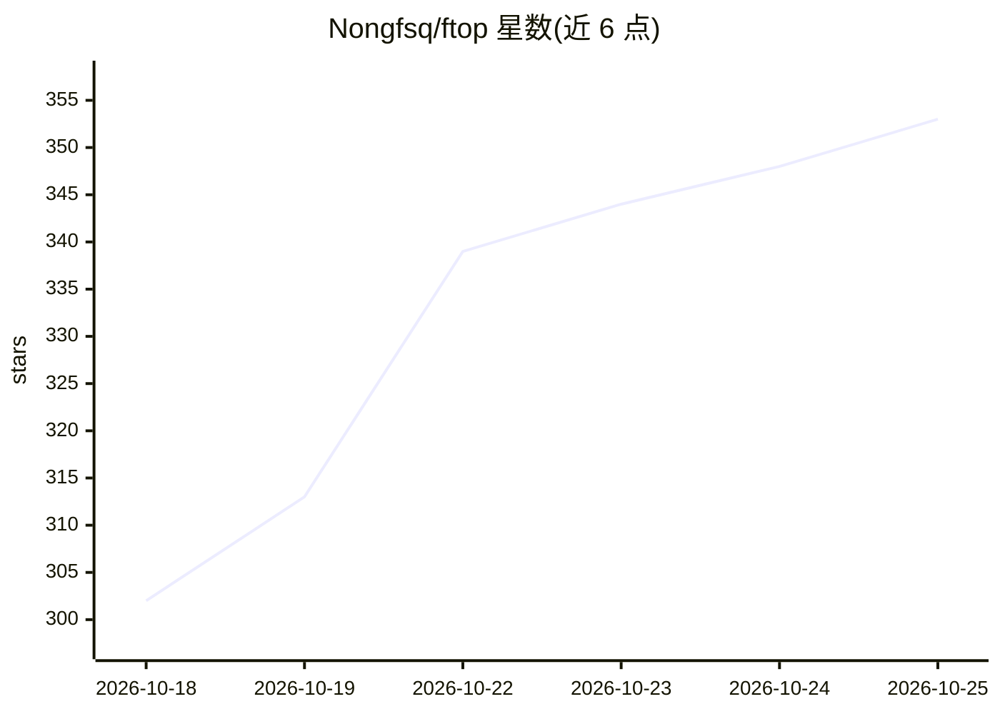

# Nongfsq/ftop

⭐ 360 · Swift · MIT · 推送 2026-10-21 · [GitHub](https://github.com/Nongfsq/ftop) · [官网](https://github.com/Nongfsq/ftop/releases/latest) · 个人维护 · 中文 README

**Apple Silicon Mac 的原生浮动面板系统监视器**

面向 Apple Silicon Mac（macOS 15+）的原生桌面系统监视器，以单个悬浮玻璃面板替代终端里的 btop/htop 类工具。展示逐核使用率与频率、内存/交换/压力、GPU 使用率频率功耗温度、整机功耗、传感器温度与最忙进程（按整机占比计 CPU）。面板可任意尺寸并自适应布局，菜单栏可放 1-3 项读数；隐藏时几乎停止读取。限制：仅 Apple Silicon，依赖 IOReport/HID 私有接口，不能上架 Mac App Store；接口为英文和中文。提供签名公证的 zip 发布包与 Xcode 源码构建两种安装方式，含自动更新。

## 筛选速览

| 维度 | 判定 | 备注 |
|---|---|---|
| AI 角色 | `ai-enhanced` | 去掉 AI 部分产品仍成立 |
| 许可风险 | `permissive` | MIT |
| 部署形态 | `desktop` | 安装包/桌面程序 |
| 模型依赖 | — | README 未给出锁定关系 |
| 硬件要求 | — | 无带数字的原话,不猜 |
| 安装摩擦 | `low` | 无编译、无系统依赖或容器化 |
| 成熟度 | — | 结构信号不足 |

## 能力要点

- 逐核/逐类核心分组显示使用率与实时频率，GPU 单列同规则
- 面板任意尺寸自适应布局，隐藏时 CPU 开销 0.0-0.1%
- sudo ftop grant 授权 setuid helper 后可列出系统进程（源码可审计）
- 每日自动检查并自动安装更新，可切换为仅提醒或从不联网

## 适用场景

- 本地跑模型或长构建时一眼看清核心、内存、GPU 与网络状态
- 在菜单栏常驻 CPU/内存/GPU 等读数
- 找出当前占用资源的具体应用

## 场景标签

 · 领域:系统工具/性能监控

## 证据(README 行号)

> L3:  A small, quiet system monitor for Apple Silicon Macs. One floating glass panel that works at any size.
> L171: - Apple Silicon only. Core grouping and per-core frequency rely on it.

## 星数曲线

2026-10-18 302 → 2026-10-25 353（+51）

---
*卡片 v1 · prompt 1.4 · 生成 2026-10-21 · 置信度 mid · 依据 README sha `471ed1c69057` · [字段定义](../../DATASET.md)*
